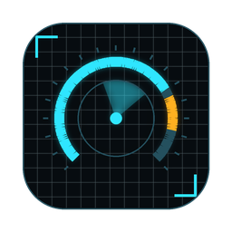
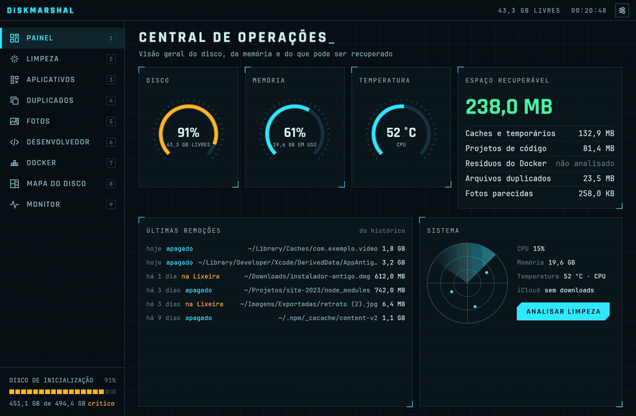
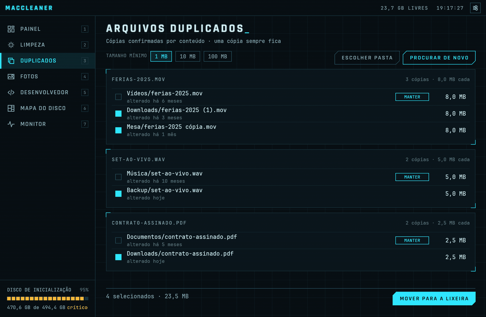
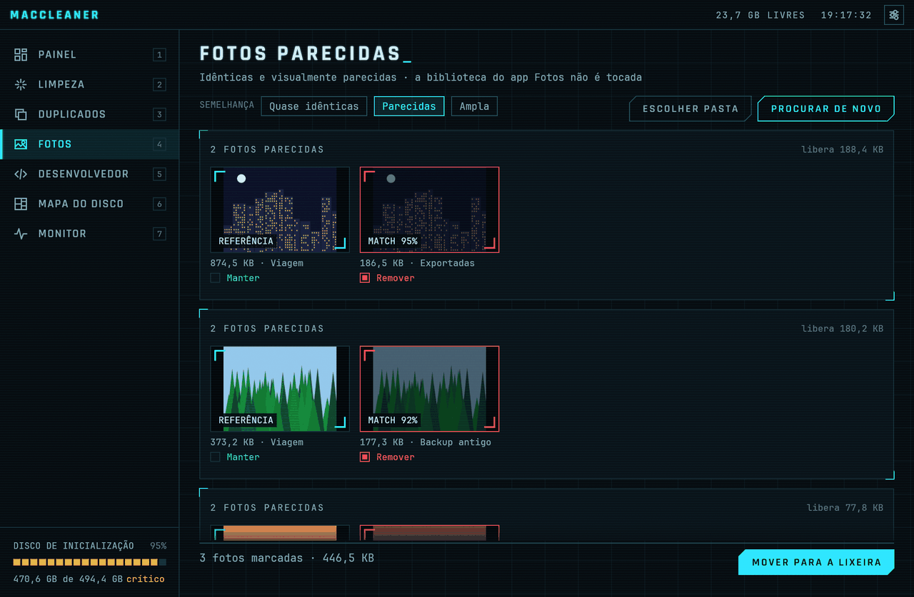
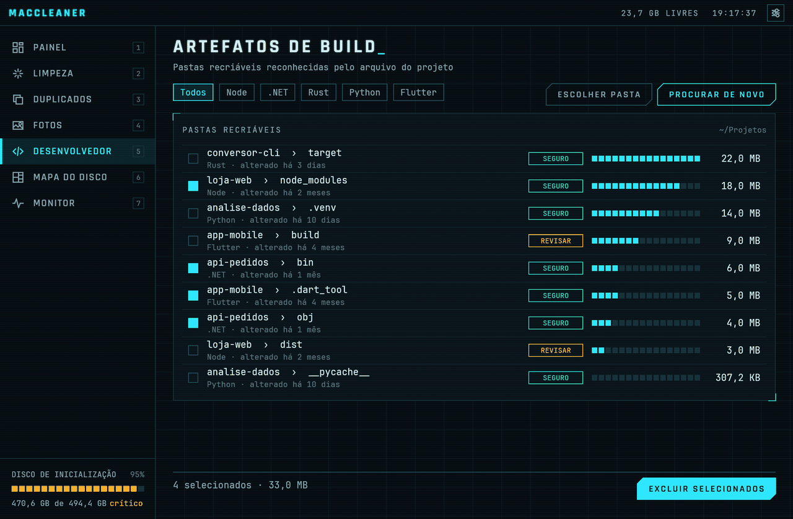
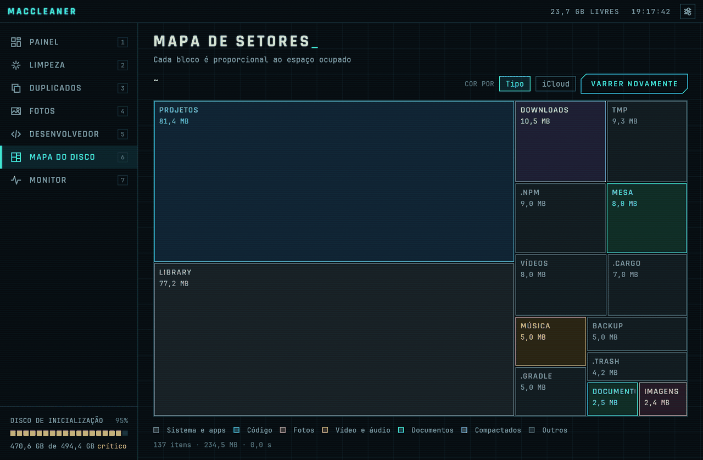
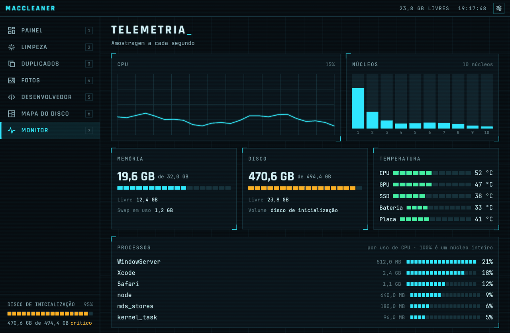
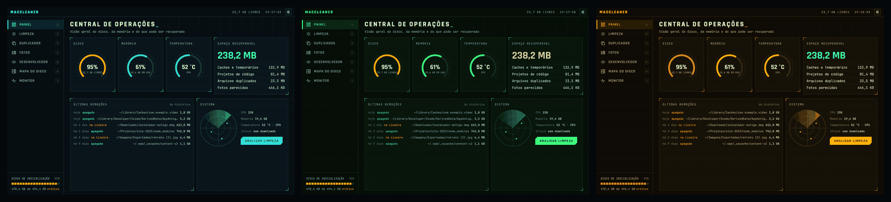
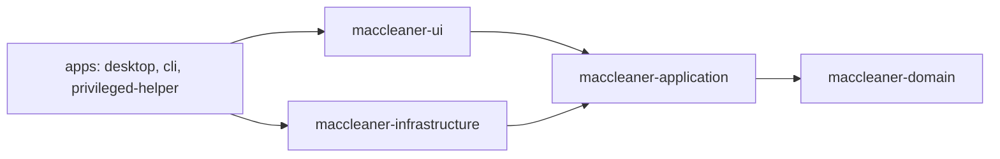

<div align="center">



# MacCleaner

**Open-source disk cleaner and system monitor for macOS, written in Rust.**

English · [Português](README.pt-BR.md)

[](https://github.com/renatoasterio/MacCleaner/actions/workflows/ci.yml)
[](LICENSE)




<sub>Screenshots of the app itself, running on demonstration data. The interface is in Brazilian Portuguese. See <a href="#project-status">Project status</a> for what is built and what has not been verified yet.</sub>

</div>

## What it is

MacCleaner finds what is filling your Mac's disk and helps you get the space back, safely.

- **See where the space went.** A map of the disk, including what is on this Mac and what is only in iCloud.
- **Remove what is safe to remove.** Caches, temporary files, logs, duplicate files, similar photos, and the build folders code projects leave behind (`node_modules`, `target`, `bin`/`obj` and friends).
- **Watch the machine.** Processor, memory, disk and temperatures, live.

It is built around one rule: **nothing is deleted without a preview and your confirmation**, and personal files always go to the Trash.

## Install and run

You need a Mac with the Xcode command line tools, Homebrew and Rust. The [getting started guide](docs/guide/getting-started.md) explains every step, including how to install those three. No programming experience is needed.

Download the source:

```bash
git clone https://github.com/renatoasterio/MacCleaner.git
```

```bash
cd MacCleaner
```

Build the app and install it:

```bash
cargo xtask install
```

That command builds the app, assembles `dist/MacCleaner.app` (the app, its helper for system cleanup and the icon), signs it and copies it to `/Applications`. The first build downloads the dependencies and takes a few minutes.

From then on, **MacCleaner opens from Launchpad or Spotlight like any other app**. The source folder is only needed to change the code or to update.

| Command | What it does |
|---|---|
| `cargo xtask install` | Builds the app and installs it in `/Applications` |
| `cargo xtask install ~/Applications` | Installs it in another folder instead |
| `cargo xtask bundle` | Only builds `dist/MacCleaner.app`, without installing |
| `cargo run --release -p maccleaner` | Opens the app straight from the source, without installing |
| `cargo run --release -p maccleaner-cli -- scan ~/Downloads` | Measures a folder from the terminal, without changing anything |

Three things worth knowing:

- **Full Disk Access is optional.** Without it the app works, but macOS hides some folders from it. The screens that read your folders show a one-line notice with a link to the right place in System Settings.
- **The signature is local (ad hoc) by default.** With it, macOS forgets the Full Disk Access permission each time the app is rebuilt and reinstalled. To sign with your own identity, set the environment variable `MACCLEANER_SIGNING_IDENTITY` to its name before running `cargo xtask install`.
- **To uninstall,** move `/Applications/MacCleaner.app` to the Trash. The removal history lives in `~/Library/Application Support/MacCleaner/`; delete that folder too if you do not want to keep it.

## Project status

All seven screens are built, and the app really deletes what you select, always after a preview and a confirmation. There is no stable release yet. It is developed and tested on one kind of machine: macOS 27 on Apple Silicon.

| Part | What it does | State |
|---|---|---|
| "Painel" (dashboard) | Disk, memory and temperature gauges, the space the other screens found, the latest removals | Built |
| "Limpeza" (cleanup) | Caches, temporary files, logs, the Trash, Xcode and package manager leftovers | Built |
| "Limpeza", group "Sistema" | `/Library/Caches` and `/Library/Logs`, after macOS authenticates an administrator | Built, not verified end to end (see below) |
| "Duplicados" (duplicates) | Files with identical content; the extra copies go to the Trash | Built |
| "Fotos" (similar photos) | Loose image files that look the same; the extra ones go to the Trash | Built |
| "Desenvolvedor" (developer) | Build and dependency folders of code projects | Built |
| "Mapa do disco" (disk map) | Treemap of the home folder or the whole disk, colored by type or by iCloud state | Built |
| "Monitor" | Processor, memory, swap, disk, temperatures and the busiest programs, live | Built |
| `maccleaner-cli scan` | Measures a folder from the terminal; read-only | Built |
| `cargo xtask install` | Builds, signs and installs `MacCleaner.app` | Built |

### Not verified yet

These parts are written and covered by automated tests on temporary folders, but were not confirmed on the real thing. Treat them accordingly.

- **System cleanup, end to end.** The macOS authentication dialog and a real cleanup of `/Library/Caches` and `/Library/Logs` were not exercised by the project's tests. The helper that does the cleaning is covered by tests on temporary folders and by its simulation mode (`--dry-run`). Whether the dialog offers Touch ID or only the password is decided by macOS.
- **A file that is really cloud-only.** The protection against iCloud downloads was not tested on a real cloud-only file.
- **Starting with reduced motion.** The app reads the "Reduce motion" switch of System Settings when it opens; this was not tested with the switch on.
- **Deleting real personal data from the interface.** Removal was exercised on test folders only.
- **Other macOS versions and Intel Macs.**

### Known limits

- Paths protected by macOS (System Integrity Protection) cannot be cleaned.
- Time Machine local snapshots, `/private/var/log` and `/private/var/tmp` are not cleaned.
- The monitor shows no fan speeds.
- Photos inside the Photos app library are out of scope: the library is never read or changed.
- APFS clones and snapshots can make the space really freed smaller than the estimate.
- The interface exists only in Brazilian Portuguese, and the appearance choices are not saved between runs.

## Screens

Screenshots of the app with demonstration data. The [usage guide](docs/guide/usage.md) explains each screen step by step.

| Dashboard ("Painel") | Cleanup ("Limpeza") |
|---|---|
|  |  |
| **Duplicates ("Duplicados")** | **Similar photos ("Fotos")** |
|  |  |
| **Developer ("Desenvolvedor")** | **Disk map ("Mapa do disco")** |
|  |  |
| **Monitor** | |
|  | |

Three palettes, chosen from the appearance icon in the status bar:



## Safety by design

- **Preview first.** Every removal lists exactly what will go, and waits for your confirmation.
- **Personal files go to the Trash.** Only caches, temporary files, logs and build folders are removed for good.
- **Protected locations.** System folders, your Documents, Desktop and Pictures, `.git` folders and the inside of apps and photo libraries can never be deleted.
- **Checked again at the last moment.** Each item is looked at again right before removal. If it changed since the preview, it is skipped.
- **No surprise downloads.** Scanning never makes macOS download files that live only in iCloud.
- **Administrator rights for one operation only.** The app never runs as an administrator and keeps no background service. macOS itself asks for Touch ID or the password, and the app never sees it.
- **No network, no telemetry.** The app never connects to the internet.

Details in the [safety guide](docs/guide/safety.md).

## Using it

**In the app**, press `1` to `7` to switch screens. Click the sliders icon at the top right to change the palette and the amount of animation. Each screen that removes something works the same way: it looks first, shows what it found, lets you choose, and asks for confirmation.

**In the terminal**, `scan` prints a summary and the largest items of a folder. It only reads. The output is in Portuguese, like the interface:

```text
Pasta              /Users/you/Projects
Itens              1.386.543
Ocupado em disco   24,2 GB
Tamanho lógico     20,6 GB
Somente na nuvem   0 B
Pastas sem acesso  0
Tempo              9,3 s

Maiores itens
     12,5 GB  portal-web/
     11,7 GB  app-mobile/
```

The [usage guide](docs/guide/usage.md) explains each screen, each button and each line of that output.

## Size and processor use

Measured on an Apple M2 Pro:

- The installed app takes about 10 MB.
- Idle, it uses roughly 3% of one processor core while its window is not in front, and roughly 10 to 15% while it is in front with full animations. Setting "Animações" (animations) to "Reduzida" (reduced) lowers that.

## How it is built

MacCleaner follows Clean Architecture. Each layer is its own crate, so the compiler rejects a dependency that points the wrong way.



| Crate | Role |
|---|---|
| `maccleaner-domain` | Rules with no I/O: file tree, deletion policy, cleanup rules, duplicates, photo similarity, treemap layout, sizes |
| `maccleaner-application` | Use cases and the ports they need |
| `maccleaner-infrastructure` | macOS adapters: disk, Trash, history, hashing, image thumbnails, system readings, permissions, privilege elevation |
| `maccleaner-ui` | The egui interface: theme, components, the seven screens |
| `apps/desktop`, `apps/cli`, `apps/privileged-helper` | Binaries that wire everything together |
| `xtask` | Project tasks: `check`, `bundle`, `install` |

One command runs formatting, lints, tests and the dependency audit:

```bash
cargo xtask check
```

The interface follows a design reference kept in [`design/prototype/index.html`](design/prototype/index.html).

## Documentation

| Guide | English | Português |
|---|---|---|
| Getting started: install, build, open | [getting-started.md](docs/guide/getting-started.md) | [getting-started.pt-BR.md](docs/guide/getting-started.pt-BR.md) |
| Usage: every screen and the command line | [usage.md](docs/guide/usage.md) | [usage.pt-BR.md](docs/guide/usage.pt-BR.md) |
| Safety: what can and cannot be deleted | [safety.md](docs/guide/safety.md) | [safety.pt-BR.md](docs/guide/safety.pt-BR.md) |
| Questions and troubleshooting | [faq.md](docs/guide/faq.md) | [faq.pt-BR.md](docs/guide/faq.pt-BR.md) |

For contributors (English): [architecture](docs/architecture.md), [conventions](docs/conventions.md), [security policy](docs/security.md) and [decision records](docs/adr/).

## What is left

**To verify.** Everything in [Not verified yet](#not-verified-yet): a system cleanup on a real Mac from the authentication dialog to the result, a scan over a file that is really cloud-only, a start with "Reduce motion" on, removal of real personal data, and runs on other macOS versions and on Intel Macs. Reports are welcome, including the ones that say "it worked".

**To live with for now.** The [known limits](#known-limits) above.

**Ideas, not commitments.**

- A signed and notarized `.app` to download, so building from source becomes optional.
- An English interface. Every text already lives in one file.
- Remembering the palette and the animation level between runs.
- Cleaning more system areas, such as Time Machine local snapshots and old logs in `/private/var/log`.
- Fan speeds in the monitor.

## Contributing

Contributions are welcome, in English or Portuguese. Start with [CONTRIBUTING.md](CONTRIBUTING.md). To report a vulnerability, follow [SECURITY.md](SECURITY.md) instead of opening a public issue.

## License

[MIT](LICENSE). The embedded typefaces, JetBrains Mono and Rajdhani, are licensed under the SIL Open Font License; their license texts are in [`assets/fonts/`](assets/fonts/).
