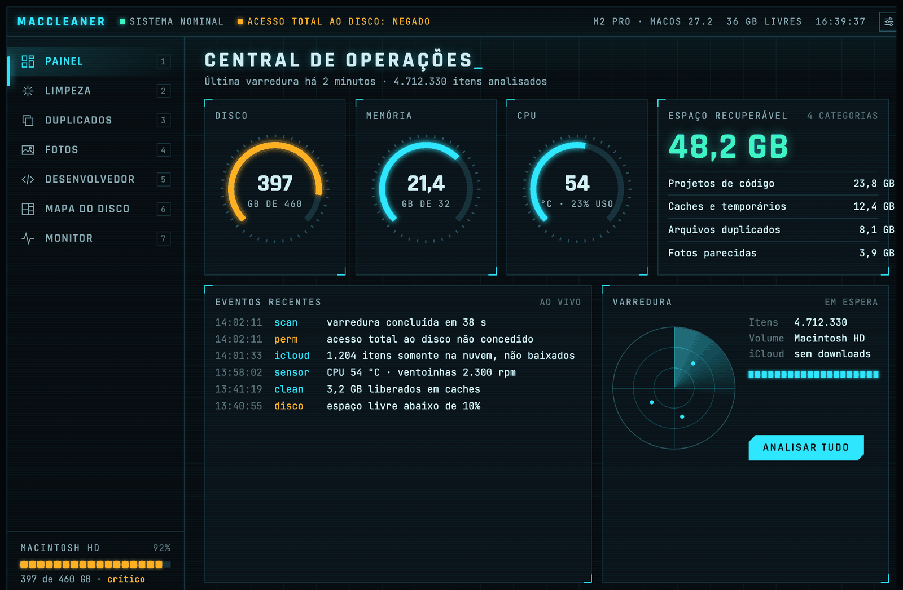
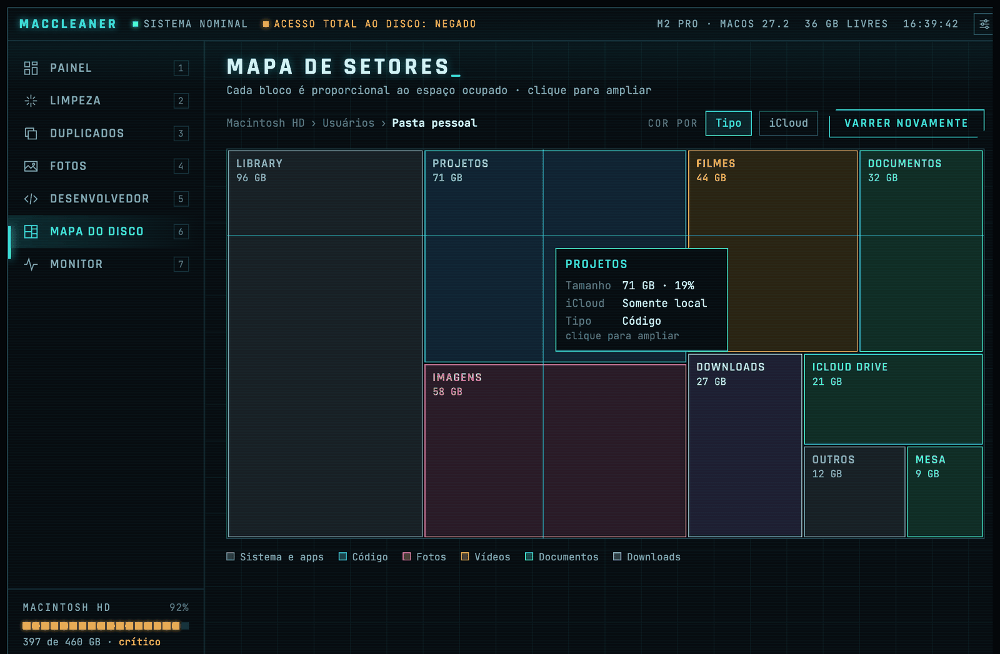
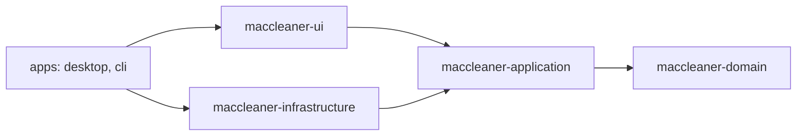

<div align="center">

# MacCleaner

**Open-source disk cleaner and system monitor for macOS, written in Rust.**

English · [Português](README.pt-BR.md)

[](https://github.com/renatoasterio/MacCleaner/actions/workflows/ci.yml)
[](LICENSE)


<sub>Tour of the interactive interface prototype. The Rust app is being built to match it. See <a href="#project-status">Project status</a> for what works today.</sub>

</div>

## What it is

MacCleaner finds what is filling your Mac's disk and helps you get the space back, safely.

- **See where the space went.** A map of the disk, including what is on this Mac and what is only in iCloud.
- **Remove what is safe to remove.** Caches, temporary files, logs, duplicate files, similar photos, and the build folders code projects leave behind (`node_modules`, `target`, `bin`/`obj` and friends).
- **Watch the machine.** Processor, memory, disk, temperature and fans, live.

It is built around one rule: **nothing is deleted without a preview and your confirmation**, and personal files always go to the Trash.

## Project status

MacCleaner is in early development. **Today it does not delete anything**: the interface shows its frame while each screen is being built, and the command line tool only reads.

| Part | State |
|---|---|
| Interface prototype (all seven screens, in `design/prototype/`) | Ready |
| Disk scan engine, with iCloud awareness | Ready |
| `maccleaner-cli scan`: measure a folder from the terminal | Ready |
| Safe deletion engine (path policy, Trash, history) | Ready, not yet wired to a screen |
| App window: status bar, navigation, palettes, start-up sequence | Ready |
| Screens: disk map, cleanup, developer, duplicates, photos, monitor, dashboard | In progress |
| Cleanup of system areas with Touch ID or password | Planned |

## Preview

These screens come from the interactive prototype, which is the visual reference the app follows. Open [`design/prototype/index.html`](design/prototype/index.html) in a browser to click through it yourself.

| Dashboard | Cleanup |
|---|---|
|  |  |
| **Disk map** | **Monitor** |
|  |  |
| **Duplicates** | **Similar photos** |
|  |  |
| **Developer** | **Confirmation before deleting** |
|  |  |

Three palettes, chosen from the appearance icon in the status bar:


And this is the app itself today, built from this repository:


## Safety by design

- **Preview first.** Every removal lists exactly what will go, and waits for your confirmation.
- **Personal files go to the Trash.** Only caches, temporary files and build folders are removed for good.
- **Protected locations.** System folders, your Documents, Desktop and Pictures, `.git` folders and the inside of apps and photo libraries can never be deleted.
- **No surprise downloads.** Scanning never makes macOS download files that live only in iCloud.
- **No network, no telemetry.** The app never connects to the internet.

Details in the [safety guide](docs/guide/safety.md).

## Quick start

You need a Mac with the Xcode command line tools, Homebrew and Rust. The [getting started guide](docs/guide/getting-started.md) explains every step, including how to install those three.

```bash
git clone https://github.com/renatoasterio/MacCleaner.git
```

```bash
cd MacCleaner
```

Open the app:

```bash
cargo run --release -p maccleaner
```

Or measure a folder from the terminal, without changing anything:

```bash
cargo run --release -p maccleaner-cli -- scan ~/Downloads
```

The first build downloads the dependencies. It takes about a minute on a recent Mac, longer on older ones.

## Using it

**In the app**, press `1` to `7` to switch screens and click the sliders icon at the top right to change the palette, the amount of animation and the glow.

**In the terminal**, `scan` prints a summary and the largest items of a folder. The output is in Portuguese, like the interface:

```text
Pasta              /Users/you/Projects
Itens              1.386.543
Ocupado em disco   24,2 GB
Tamanho lógico     20,6 GB
Somente na nuvem   0 B
Pastas sem acesso  0
Tempo              9,3 s

Maiores itens
     12,5 GB  portal-web/
     11,7 GB  app-mobile/
```

The [usage guide](docs/guide/usage.md) explains each line and each part of the window.

## How it is built

MacCleaner follows Clean Architecture. Each layer is its own crate, so the compiler rejects a dependency that points the wrong way.



| Crate | Role |
|---|---|
| `maccleaner-domain` | Rules with no I/O: file tree, deletion policy, sizes |
| `maccleaner-application` | Use cases and the ports they need |
| `maccleaner-infrastructure` | macOS adapters: disk, Trash, history, clock |
| `maccleaner-ui` | The egui interface: theme, components, screens |
| `apps/desktop`, `apps/cli` | Binaries that wire everything together |

One command runs formatting, lints, tests and the dependency audit:

```bash
cargo xtask check
```

## Documentation

| Guide | English | Português |
|---|---|---|
| Getting started: install, build, run | [getting-started.md](docs/guide/getting-started.md) | [getting-started.pt-BR.md](docs/guide/getting-started.pt-BR.md) |
| Usage: the app and the command line | [usage.md](docs/guide/usage.md) | [usage.pt-BR.md](docs/guide/usage.pt-BR.md) |
| Safety: what can and cannot be deleted | [safety.md](docs/guide/safety.md) | [safety.pt-BR.md](docs/guide/safety.pt-BR.md) |
| Questions and troubleshooting | [faq.md](docs/guide/faq.md) | [faq.pt-BR.md](docs/guide/faq.pt-BR.md) |

For contributors (English): [architecture](docs/architecture.md), [conventions](docs/conventions.md), [security policy](docs/security.md) and [decision records](docs/adr/).

## Roadmap

1. Disk map screen, with the local and iCloud view.
2. Cleanup of the user's caches, temporary files and logs.
3. Cleanup of system areas, authorized with Touch ID or password.
4. Developer screen: build and dependency folders per project.
5. Duplicate files.
6. Similar photos.
7. Live monitor and the dashboard that ties everything together.
8. A signed `.app` to download, so building from source becomes optional.

## Contributing

Contributions are welcome, in English or Portuguese. Start with [CONTRIBUTING.md](CONTRIBUTING.md). To report a vulnerability, follow [SECURITY.md](SECURITY.md) instead of opening a public issue.

## License

[MIT](LICENSE). The embedded typefaces, JetBrains Mono and Rajdhani, are licensed under the SIL Open Font License; their license texts are in [`assets/fonts/`](assets/fonts/).
