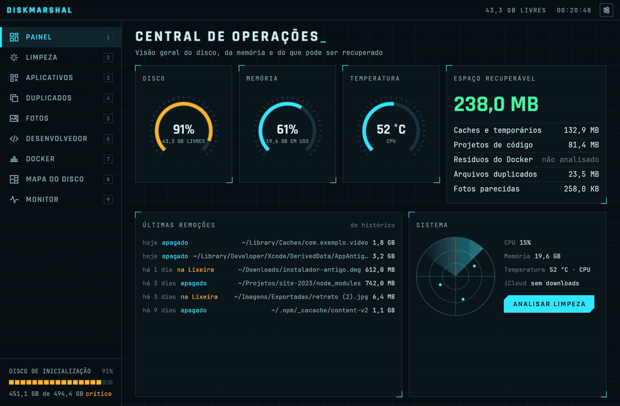
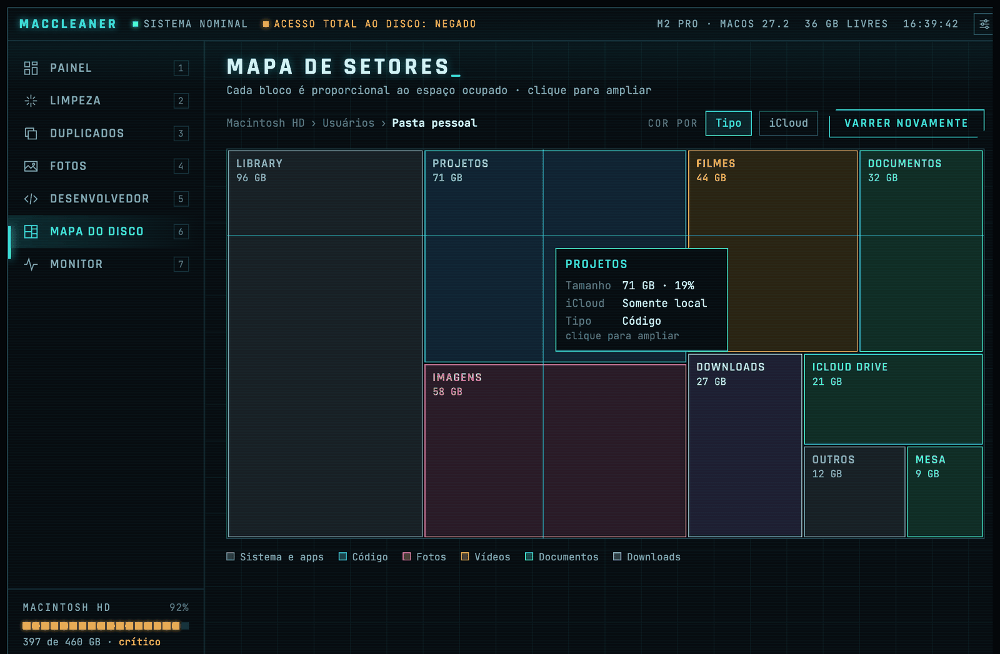
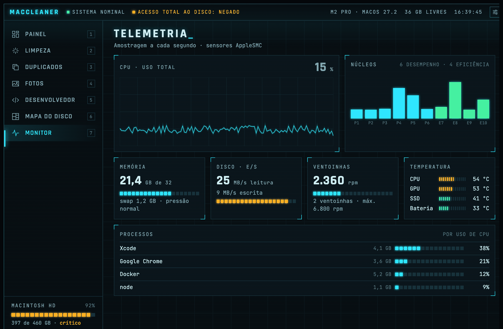
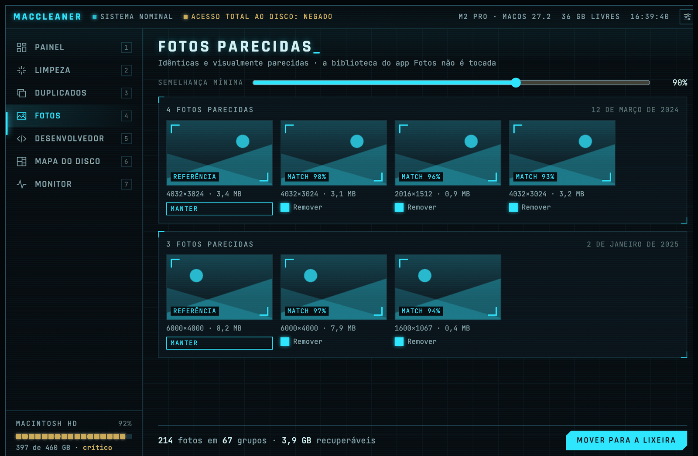
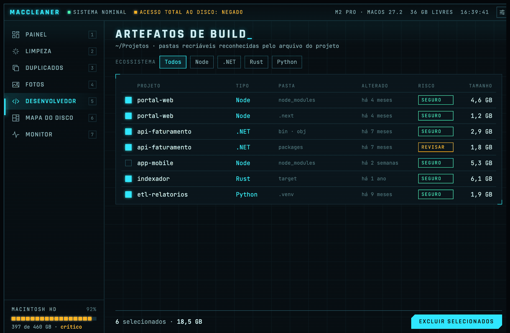
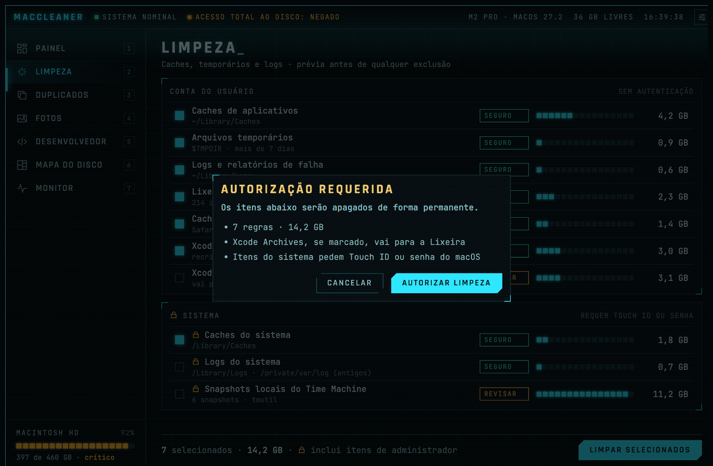
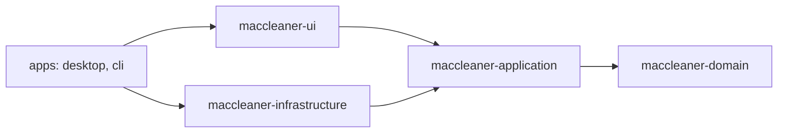

<div align="center">

# MacCleaner

**Limpador de disco e monitor do sistema para macOS, de código aberto, escrito em Rust.**

[English](README.md) · Português

[](https://github.com/renatoasterio/MacCleaner/actions/workflows/ci.yml)
[](LICENSE)




<sub>Passeio pelo protótipo interativo da interface. O app em Rust está sendo construído para ficar igual. Veja em <a href="#estado-do-projeto">Estado do projeto</a> o que já funciona hoje.</sub>

</div>

## O que é

O MacCleaner descobre o que está enchendo o disco do seu Mac e ajuda a recuperar o espaço, com segurança.

- **Veja para onde foi o espaço.** Um mapa do disco, mostrando o que está neste Mac e o que está só no iCloud.
- **Remova o que é seguro remover.** Caches, arquivos temporários, logs, arquivos duplicados, fotos parecidas e as pastas de build que projetos de código deixam para trás (`node_modules`, `target`, `bin`/`obj` e companhia).
- **Acompanhe a máquina.** Processador, memória, disco, temperatura e ventoinhas, ao vivo.

Ele é construído em torno de uma regra: **nada é apagado sem prévia e sem a sua confirmação**, e arquivos pessoais sempre vão para a Lixeira.

## Estado do projeto

O MacCleaner está em desenvolvimento inicial. **Hoje ele não apaga nada**: a interface mostra a moldura enquanto cada tela é construída, e a ferramenta de linha de comando só lê.

| Parte | Estado |
|---|---|
| Protótipo da interface (as sete telas, em `design/prototype/`) | Pronto |
| Motor de varredura do disco, ciente do iCloud | Pronto |
| `maccleaner-cli scan`: medir uma pasta pelo terminal | Pronto |
| Motor de exclusão segura (regras de caminho, Lixeira, histórico) | Pronto, ainda não ligado a uma tela |
| Janela do app: barra de status, navegação, paletas, abertura | Pronto |
| Telas: mapa do disco, limpeza, desenvolvedor, duplicados, fotos, monitor, painel | Em andamento |
| Limpeza de áreas do sistema com Touch ID ou senha | Planejado |

## Prévia

Estas telas vêm do protótipo interativo, que é a referência visual seguida pelo app. Abra [`design/prototype/index.html`](design/prototype/index.html) em um navegador para clicar por conta própria.

| Painel | Limpeza |
|---|---|
|  |  |
| **Mapa do disco** | **Monitor** |
|  |  |
| **Duplicados** | **Fotos parecidas** |
|  |  |
| **Desenvolvedor** | **Confirmação antes de apagar** |
|  |  |

Três paletas, escolhidas pelo ícone de aparência na barra de status:


E este é o app de verdade hoje, compilado a partir deste repositório:


## Segurança desde o projeto

- **Prévia primeiro.** Toda remoção lista exatamente o que vai sair e espera a sua confirmação.
- **Arquivos pessoais vão para a Lixeira.** Só caches, temporários e pastas de build são removidos de vez.
- **Locais protegidos.** Pastas do sistema, seus Documentos, Mesa e Imagens, pastas `.git` e o interior de apps e bibliotecas de fotos nunca podem ser apagados.
- **Sem downloads de surpresa.** A varredura nunca faz o macOS baixar arquivos que estão só no iCloud.
- **Sem rede, sem telemetria.** O app nunca se conecta à internet.

Detalhes no [guia de segurança](docs/guide/safety.pt-BR.md).

## Começo rápido

Você precisa de um Mac com as ferramentas de linha de comando do Xcode, o Homebrew e o Rust. O [guia de primeiros passos](docs/guide/getting-started.pt-BR.md) explica cada etapa, inclusive como instalar esses três.

```bash
git clone https://github.com/renatoasterio/MacCleaner.git
```

```bash
cd MacCleaner
```

Abra o app:

```bash
cargo run --release -p maccleaner
```

Ou meça uma pasta pelo terminal, sem alterar nada:

```bash
cargo run --release -p maccleaner-cli -- scan ~/Downloads
```

A primeira compilação baixa as dependências. Leva cerca de um minuto em um Mac recente e mais em máquinas antigas.

## Como usar

**No app**, pressione `1` a `7` para trocar de tela e clique no ícone de controles, no canto superior direito, para mudar a paleta, a quantidade de animação e o brilho.

**No terminal**, o `scan` mostra um resumo e os maiores itens de uma pasta:

```text
Pasta              /Users/voce/Projetos
Itens              1.386.543
Ocupado em disco   24,2 GB
Tamanho lógico     20,6 GB
Somente na nuvem   0 B
Pastas sem acesso  0
Tempo              9,3 s

Maiores itens
     12,5 GB  portal-web/
     11,7 GB  app-mobile/
```

O [guia de uso](docs/guide/usage.pt-BR.md) explica cada linha e cada parte da janela.

## Como é construído

O MacCleaner segue a Clean Architecture. Cada camada é um crate próprio, então o compilador recusa uma dependência que aponte para o lado errado.



| Crate | Papel |
|---|---|
| `maccleaner-domain` | Regras sem acesso a disco: árvore de arquivos, política de exclusão, tamanhos |
| `maccleaner-application` | Casos de uso e as portas de que eles precisam |
| `maccleaner-infrastructure` | Adaptadores do macOS: disco, Lixeira, histórico, relógio |
| `maccleaner-ui` | A interface em egui: tema, componentes, telas |
| `apps/desktop`, `apps/cli` | Binários que ligam tudo |

Um comando roda formatação, lints, testes e a auditoria de dependências:

```bash
cargo xtask check
```

## Documentação

| Guia | English | Português |
|---|---|---|
| Primeiros passos: instalar, compilar, abrir | [getting-started.md](docs/guide/getting-started.md) | [getting-started.pt-BR.md](docs/guide/getting-started.pt-BR.md) |
| Uso: o app e a linha de comando | [usage.md](docs/guide/usage.md) | [usage.pt-BR.md](docs/guide/usage.pt-BR.md) |
| Segurança: o que pode e o que não pode ser apagado | [safety.md](docs/guide/safety.md) | [safety.pt-BR.md](docs/guide/safety.pt-BR.md) |
| Perguntas e solução de problemas | [faq.md](docs/guide/faq.md) | [faq.pt-BR.md](docs/guide/faq.pt-BR.md) |

Para quem contribui (em inglês): [arquitetura](docs/architecture.md), [convenções](docs/conventions.md), [política de segurança](docs/security.md) e [registros de decisão](docs/adr/).

## Próximos passos

1. Tela do mapa do disco, com a visão local e iCloud.
2. Limpeza de caches, temporários e logs do usuário.
3. Limpeza de áreas do sistema, autorizada com Touch ID ou senha.
4. Tela do desenvolvedor: pastas de build e dependências por projeto.
5. Arquivos duplicados.
6. Fotos parecidas.
7. Monitor ao vivo e o painel que reúne tudo.
8. Um `.app` assinado para baixar, tornando opcional compilar a partir do código.

## Como contribuir

Contribuições são bem-vindas, em português ou inglês. Comece pelo [CONTRIBUTING.md](CONTRIBUTING.md). Para relatar uma vulnerabilidade, siga o [SECURITY.md](SECURITY.md) em vez de abrir uma issue pública.

## Licença

[MIT](LICENSE). As fontes embarcadas, JetBrains Mono e Rajdhani, são licenciadas sob a SIL Open Font License; os textos das licenças estão em [`assets/fonts/`](assets/fonts/).
