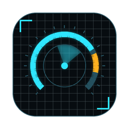
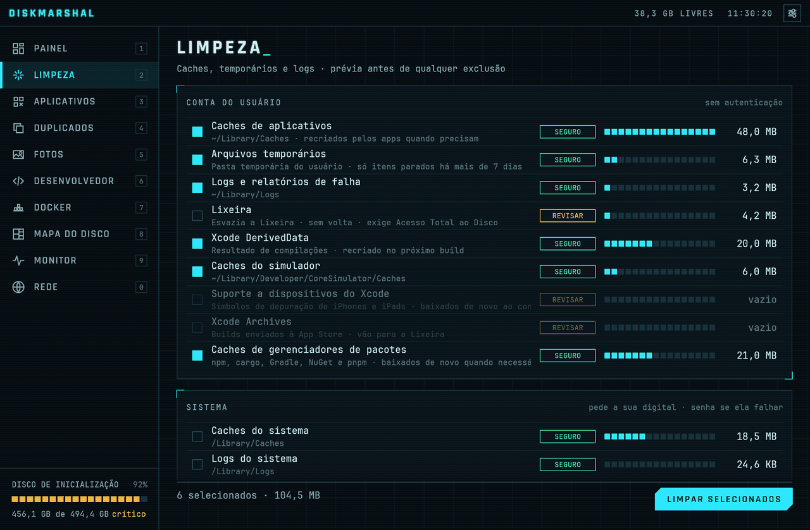
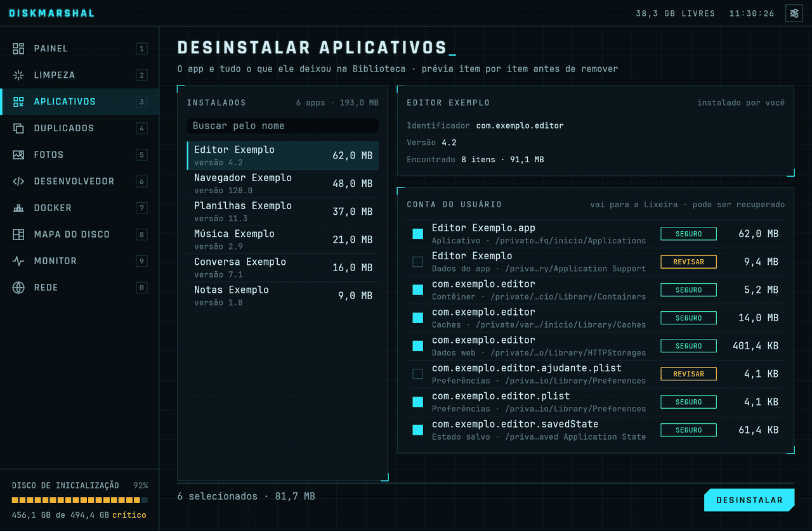
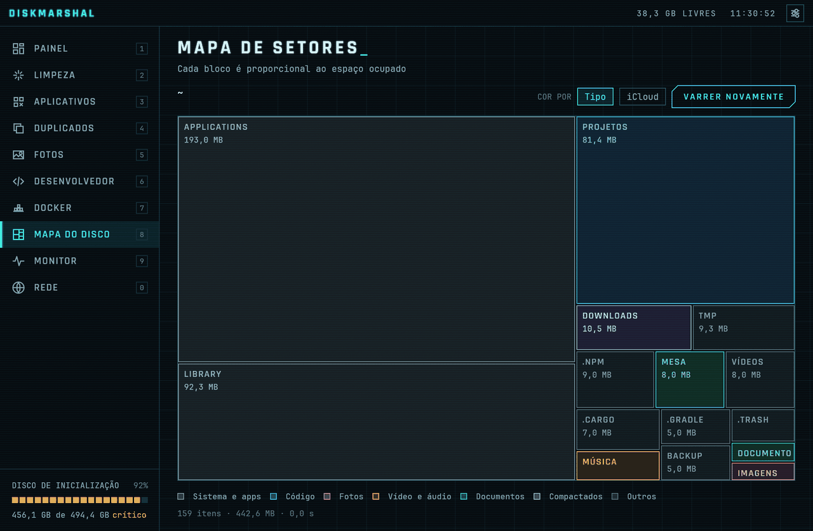
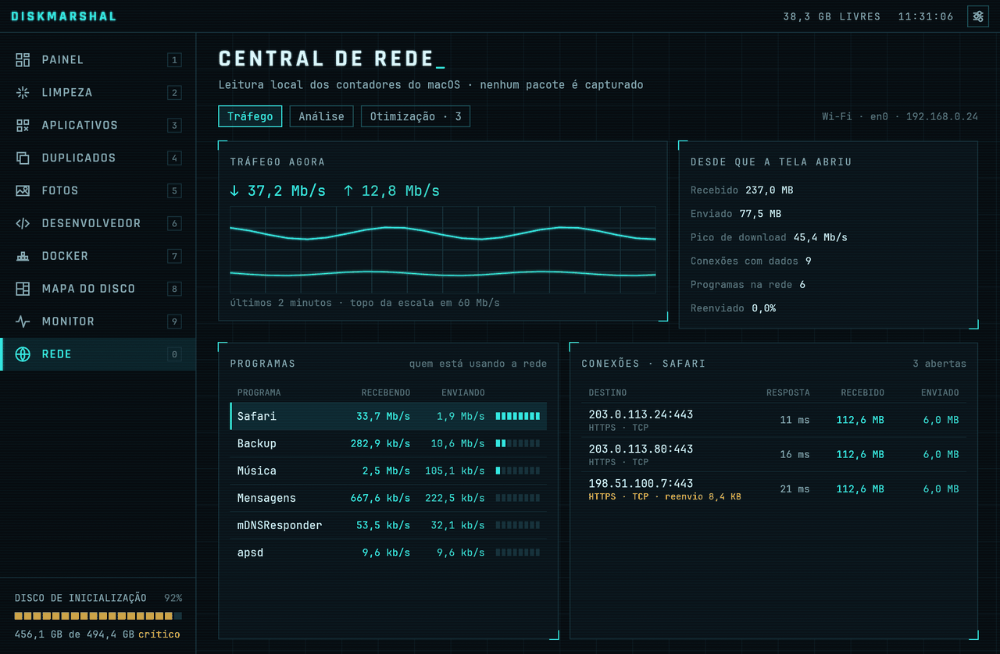
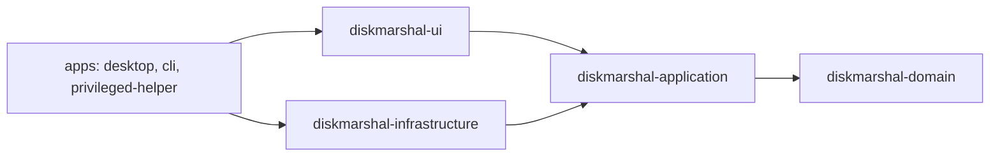

<div align="center">



# DiskMarshal

**Limpador de disco e monitor do sistema para macOS, de código aberto, escrito em Rust.**

[English](README.md) · Português

[](https://github.com/renatoasterio/DiskMarshal/actions/workflows/ci.yml)
[](LICENSE)


<sub>Capturas do próprio app, rodando com dados de demonstração. Veja em <a href="#estado-do-projeto">Estado do projeto</a> o que está pronto e o que ainda não foi verificado.</sub>

</div>

## O que é

O DiskMarshal descobre o que está enchendo o disco do seu Mac e ajuda a recuperar o espaço, com segurança.

- **Veja para onde foi o espaço.** Um mapa do disco, mostrando o que está neste Mac e o que está só no iCloud.
- **Remova o que é seguro remover.** Caches, arquivos temporários, logs, arquivos duplicados, fotos parecidas e as pastas de build que projetos de código deixam para trás (`node_modules`, `target`, `bin`/`obj` e companhia).
- **Desinstale um app junto com o que ele deixou.** O app, os caches, os ajustes e os dados privados dele, listados item por item antes de qualquer coisa sair.
- **Limpe as sobras do Docker.** O cache de build, e as imagens, os containers parados e os volumes que nada usa.
- **Acompanhe a máquina.** Processador, memória, disco e temperaturas, ao vivo.

Ele é construído em torno de uma regra: **nada é apagado sem prévia e sem a sua confirmação**, e arquivos pessoais sempre vão para a Lixeira.

## Instalar e abrir

Você precisa de um Mac com as ferramentas de linha de comando do Xcode, o Homebrew e o Rust. O [guia de primeiros passos](docs/guide/getting-started.pt-BR.md) explica cada etapa, inclusive como instalar esses três. Não é preciso saber programar.

Baixe o código:

```bash
git clone https://github.com/renatoasterio/DiskMarshal.git
```

```bash
cd DiskMarshal
```

Compile o app e instale:

```bash
cargo xtask install
```

Esse comando compila o app, monta o `dist/DiskMarshal.app` (o app, o auxiliar da limpeza de sistema e o ícone), assina e copia para `/Applications` (a pasta Aplicativos). A primeira compilação baixa as dependências e leva alguns minutos.

Daí em diante, **o DiskMarshal abre pelo Launchpad ou pelo Spotlight, como qualquer outro app**. A pasta do código só é necessária para alterar o código ou para atualizar.

| Comando | O que faz |
|---|---|
| `cargo xtask install` | Compila o app e instala em `/Applications` |
| `cargo xtask install ~/Applications` | Instala em outra pasta |
| `cargo xtask bundle` | Só monta o `dist/DiskMarshal.app`, sem instalar |
| `cargo run --release -p diskmarshal` | Abre o app direto do código, sem instalar |
| `cargo run --release -p diskmarshal-cli -- scan ~/Downloads` | Mede uma pasta pelo terminal, sem alterar nada |

Três coisas que vale saber:

- **O Acesso Total ao Disco é opcional.** Sem ele o app funciona, mas o macOS esconde algumas pastas dele. As telas que leem as suas pastas mostram um aviso de uma linha com um link para o lugar certo nos Ajustes do Sistema.
- **A assinatura é local (ad hoc) por padrão.** Com ela, o macOS esquece a permissão de Acesso Total ao Disco toda vez que o app é recompilado e reinstalado. Para assinar com a sua própria identidade, defina a variável de ambiente `DISKMARSHAL_SIGNING_IDENTITY` com o nome dela antes de rodar `cargo xtask install`.
- **Para desinstalar,** mova o `/Applications/DiskMarshal.app` para a Lixeira. O histórico de remoções fica em `~/Library/Application Support/DiskMarshal/`; apague essa pasta também se não quiser guardá-lo.

## Estado do projeto

As dez telas estão prontas, e o app apaga de verdade o que você seleciona, sempre depois de uma prévia e de uma confirmação. Ainda não há uma versão estável. Ele é desenvolvido e testado em um único tipo de máquina: macOS 27 em Apple Silicon.

| Parte | O que faz | Estado |
|---|---|---|
| "Painel" | Medidores de disco, memória e temperatura, o espaço que as outras telas encontraram, as últimas remoções | Pronto |
| "Limpeza" | Caches, temporários, logs, a Lixeira, sobras do Xcode e de gerenciadores de pacotes | Pronto |
| "Limpeza", grupo "Sistema" | `/Library/Caches` e `/Library/Logs`, depois que o macOS autentica um administrador | Pronto, confirmado à mão em um Mac (veja abaixo) |
| "Aplicativos" | Desinstala um app junto com o que ele deixou na Biblioteca; o que é seu vai para a Lixeira | Pronto, confirmado à mão em um Mac (veja abaixo) |
| "Aplicativos", grupo "Sistema" | Apps que a App Store ou um instalador colocou ali, e o que eles deixaram em `/Library`, depois que o macOS autentica um administrador | Pronto, confirmado à mão em um Mac (veja abaixo) |
| "Duplicados" | Arquivos com conteúdo idêntico; as cópias a mais vão para a Lixeira | Pronto |
| "Fotos" | Imagens soltas em pastas que parecem a mesma; as que sobram vão para a Lixeira | Pronto |
| "Desenvolvedor" | Pastas de build e de dependências de projetos de código | Pronto |
| "Docker" | O cache de build, as imagens, os containers parados e os volumes que nada usa, removidos pelo próprio Docker | Pronto, remoção não verificada em um Docker de verdade (veja abaixo) |
| "Mapa do disco" | Mapa em blocos da pasta pessoal ou do disco inteiro, colorido por tipo ou por estado no iCloud | Pronto |
| "Monitor" | Processador, memória, swap, disco, temperaturas e os programas mais ativos, ao vivo | Pronto |
| "Rede" | Quais programas estão usando a rede e a que velocidade, uma análise da conexão com teste de velocidade opcional e três ajustes que podem deixá-la mais rápida | Pronto, mudança de ajuste não verificada na situação real (veja abaixo) |
| `diskmarshal-cli scan` | Mede uma pasta pelo terminal; somente leitura | Pronto |
| `diskmarshal-cli apps`, `diskmarshal-cli docker` | Mostram o que essas duas telas encontrariam; somente leitura | Pronto |
| `diskmarshal-cli network` | Mostra quais programas estão usando a rede e a que velocidade; somente leitura | Pronto |
| `cargo xtask install` | Compila, assina e instala o `DiskMarshal.app` | Pronto |

### Confirmado à mão

Os testes automáticos não digitam senha nem colocam o dedo no sensor, então estas partes foram confirmadas à mão com o app instalado, em 18 de novembro de 2026, na máquina de desenvolvimento (macOS 27.2 em Apple Silicon):

- **Limpeza de sistema com a digital.** Com o Touch ID ativado para o `sudo`, a limpeza de `/Library/Logs` pediu a digital no diálogo do macOS, removeu os itens e os registrou no histórico.
- **Desinstalar apps de verdade.** Dois apps de `/Applications` foram desinstalados: cada app foi removido depois do diálogo de senha do macOS, e o que ele tinha deixado na Biblioteca do usuário foi para a Lixeira.

Um Mac é um Mac só: a próxima seção diz o que isso não cobre.

### Ainda não verificado

Estas partes estão escritas e cobertas por testes automáticos em pastas temporárias, mas não foram confirmadas na situação real. Leve isso em conta.

- **O restante da limpeza de sistema.** Uma limpeza real de `/Library/Caches`, a limpeza de sistema pelo diálogo de senha e o diálogo de senha que aparece depois de uma digital cancelada não foram exercitados na situação real. O auxiliar que faz a limpeza é coberto por testes em pastas temporárias e pelo seu modo de simulação (`--dry-run`).
- **Um arquivo que está realmente só na nuvem.** A proteção contra downloads do iCloud não foi testada com um arquivo que esteja de fato só na nuvem.
- **Abrir com movimento reduzido.** O app lê a opção "Reduzir movimento" dos Ajustes do Sistema ao abrir; isso não foi testado com a opção ligada.
- **Apagar dados pessoais reais pela interface.** A remoção foi exercitada apenas em pastas de teste.
- **Outras versões do macOS e Macs com Intel.**
- **O restante do desinstalador.** Desinstalar com a digital e remover o que um app deixou em `/Library` não foram exercitados na situação real: dos dois apps acima, nada foi removido de lá. Essa parte rodou em pastas de teste e no modo de simulação do auxiliar.
- **Mudar um ajuste de rede.** Desligar a procura por proxy, limpar o cache de DNS e definir os servidores de nomes passam pelo auxiliar, que foi exercitado só no modo de simulação: ele confere o pedido contra o Mac e não altera nada. A leitura do tráfego e a análise da conexão foram conferidas na rede real da máquina de desenvolvimento. O teste de velocidade foi conferido rodando a ferramenta do macOS à mão e lendo a resposta dela, não apertando o botão.
- **Remover de um Docker de verdade.** A leitura do que o Docker guarda foi conferida em um Docker 24 real. A remoção rodou contra um programa substituto, que responde como o Docker. Não foi conferido se o Docker Desktop devolve ao macOS o espaço liberado.

### Limites conhecidos

- Caminhos protegidos pelo macOS (Proteção da Integridade do Sistema, SIP) não podem ser limpos.
- Snapshots locais do Time Machine, `/private/var/log` e `/private/var/tmp` não são limpos.
- O monitor não mostra a velocidade das ventoinhas.
- A tela de rede lê contadores, não pacotes: ela mostra quem fala com qual endereço e quanto, nunca o conteúdo. Uma conexão aberta e fechada entre duas leituras não é vista.
- A tela de rede não deixa a conexão mais rápida do que o plano contratado. Ela remove o que a atrasa no Mac.
- Fotos dentro da biblioteca do app Fotos ficam de fora: a biblioteca nunca é lida nem alterada.
- Clones e snapshots do APFS podem fazer o espaço realmente liberado ser menor que o estimado.
- O desinstalador encontra o que leva o identificador ou o nome do app. O que um app guarda com outro nome fica.
- O Docker é consultado pelo programa de linha de comando dele, procurado onde os instaladores o colocam. Outros motores de container não são suportados.
- A interface existe só em português do Brasil, e as escolhas de aparência não são salvas entre uma abertura e outra.

## Telas

Capturas do app com dados de demonstração. O [guia de uso](docs/guide/usage.pt-BR.md) explica cada tela passo a passo.

| Painel | Limpeza |
|---|---|
|  |  |
| **Aplicativos** | **Duplicados** |
|  |  |
| **Fotos parecidas** | **Desenvolvedor** |
|  |  |
| **Docker** | **Mapa do disco** |
|  |  |
| **Monitor** | **Rede** |
|  |  |

Três paletas, escolhidas pelo ícone de aparência na barra de status:


## Segurança desde o projeto

- **Prévia primeiro.** Toda remoção lista exatamente o que vai sair e espera a sua confirmação.
- **Arquivos pessoais vão para a Lixeira.** Só caches, temporários, logs e pastas de build são removidos de vez.
- **Locais protegidos.** Pastas do sistema, seus Documentos, Mesa e Imagens, pastas `.git` e o interior de apps e bibliotecas de fotos nunca podem ser apagados.
- **Conferido de novo no último instante.** Cada item é olhado de novo logo antes da remoção. Se mudou desde a prévia, é pulado.
- **Sem downloads de surpresa.** A varredura nunca faz o macOS baixar arquivos que estão só no iCloud.
- **Privilégio de administrador só para uma operação.** O app nunca roda como administrador e não deixa nenhum serviço em segundo plano. O próprio macOS pede a senha, ou a sua digital depois que você [ativa essa opção](docs/guide/usage.pt-BR.md#usar-a-digital-em-vez-da-senha), e o app nunca vê nenhuma das duas.
- **Sem telemetria, e rede só quando você pede.** O app não envia nada sobre você e não procura atualizações. Ele usa a rede em dois casos, cada um iniciado por um botão da tela de rede: a análise da conexão (alguns pings e consultas de nomes) e o teste de velocidade (que transfere dados de verdade com os servidores da Apple).

Detalhes no [guia de segurança](docs/guide/safety.pt-BR.md).

## Como usar

**No app**, pressione `1` a `7` para trocar de tela. Clique no ícone de controles, no canto superior direito, para mudar a paleta e a quantidade de animação. Toda tela que remove alguma coisa funciona do mesmo jeito: primeiro procura, mostra o que encontrou, deixa você escolher e pede confirmação.

**No terminal**, o `scan` mostra um resumo e os maiores itens de uma pasta. Ele só lê:

```text
Pasta              /Users/voce/Projetos
Itens              1.386.543
Ocupado em disco   24,2 GB
Tamanho lógico     20,6 GB
Somente na nuvem   0 B
Pastas sem acesso  0
Tempo              9,3 s

Maiores itens
     12,5 GB  portal-web/
     11,7 GB  app-mobile/
```

O [guia de uso](docs/guide/usage.pt-BR.md) explica cada tela, cada botão e cada linha dessa saída.

## Tamanho e uso do processador

Medido em um Apple M2 Pro:

- O app instalado ocupa cerca de 10 MB.
- Parado, ele usa mais ou menos 3% de um núcleo do processador enquanto a janela não está na frente, e de 10 a 15% enquanto está na frente com as animações completas. Mudar "Animações" para "Reduzida" diminui esse uso.

## Como é construído

O DiskMarshal segue a Clean Architecture. Cada camada é um crate próprio, então o compilador recusa uma dependência que aponte para o lado errado.



| Crate | Papel |
|---|---|
| `diskmarshal-domain` | Regras sem acesso a disco: árvore de arquivos, política de exclusão, regras de limpeza, duplicados, semelhança de fotos, desenho do mapa, tamanhos |
| `diskmarshal-application` | Casos de uso e as portas de que eles precisam |
| `diskmarshal-infrastructure` | Adaptadores do macOS: disco, Lixeira, histórico, hash de conteúdo, miniaturas de imagens, leituras do sistema, permissões, elevação de privilégio |
| `diskmarshal-ui` | A interface em egui: tema, componentes, as dez telas |
| `apps/desktop`, `apps/cli`, `apps/privileged-helper` | Binários que ligam tudo |
| `xtask` | Tarefas do projeto: `check`, `bundle`, `install` |

Um comando roda formatação, lints, testes e a auditoria de dependências:

```bash
cargo xtask check
```

A interface segue uma referência de design guardada em [`design/prototype/index.html`](design/prototype/index.html).

## Documentação

| Guia | English | Português |
|---|---|---|
| Primeiros passos: instalar, compilar, abrir | [getting-started.md](docs/guide/getting-started.md) | [getting-started.pt-BR.md](docs/guide/getting-started.pt-BR.md) |
| Uso: cada tela e a linha de comando | [usage.md](docs/guide/usage.md) | [usage.pt-BR.md](docs/guide/usage.pt-BR.md) |
| Segurança: o que pode e o que não pode ser apagado | [safety.md](docs/guide/safety.md) | [safety.pt-BR.md](docs/guide/safety.pt-BR.md) |
| Perguntas e solução de problemas | [faq.md](docs/guide/faq.md) | [faq.pt-BR.md](docs/guide/faq.pt-BR.md) |

Para quem contribui (em inglês): [arquitetura](docs/architecture.md), [convenções](docs/conventions.md), [política de segurança](docs/security.md) e [registros de decisão](docs/adr/).

## O que falta

**Verificar.** Tudo o que está em [Ainda não verificado](#ainda-não-verificado): as partes da limpeza de sistema e do desinstalador que não foram confirmadas à mão; uma varredura sobre um arquivo que esteja realmente só na nuvem; uma abertura com "Reduzir movimento" ligado; a remoção de dados pessoais reais; e o uso em outras versões do macOS e em Macs com Intel. Relatos são bem-vindos, inclusive os que dizem "funcionou".

**Conviver por enquanto.** Os [limites conhecidos](#limites-conhecidos) acima.

**Ideias, não compromissos.**

- Um `.app` assinado e notarizado para baixar, tornando opcional compilar a partir do código.
- Interface em inglês. Todos os textos já ficam em um único arquivo.
- Lembrar a paleta e o nível de animação entre uma abertura e outra.
- Limpar mais áreas do sistema, como os snapshots locais do Time Machine e logs antigos em `/private/var/log`.
- Velocidade das ventoinhas no monitor.

## Como contribuir

Contribuições são bem-vindas, em português ou inglês. Comece pelo [CONTRIBUTING.md](CONTRIBUTING.md). Para relatar uma vulnerabilidade, siga o [SECURITY.md](SECURITY.md) em vez de abrir uma issue pública.

## Licença

[MIT](LICENSE). As fontes embarcadas, JetBrains Mono e Rajdhani, são licenciadas sob a SIL Open Font License; os textos das licenças estão em [`assets/fonts/`](assets/fonts/).
