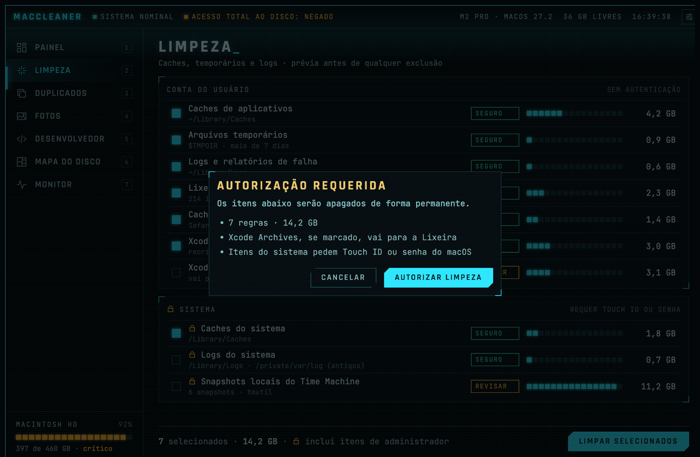
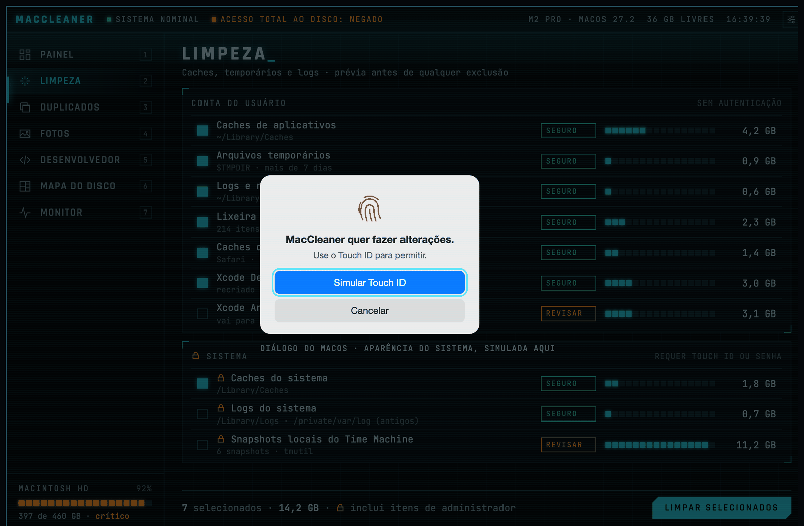

# Safety

English · [Português](safety.pt-BR.md)

A cleaner deletes files, so a mistake can cost you data. This page explains, in plain terms, the rules MacCleaner follows so that does not happen.

> **Where things stand today.** The app does not delete anything yet, and the command line tool only reads. The deletion engine described here exists and is tested, but no screen uses it yet. This page describes how it behaves, so you know what to expect when the cleanup screens arrive.

## The five rules

### 1. You always see a preview first

Before anything is removed, MacCleaner lists exactly what will go and how much space it frees. Nothing happens until you confirm.



### 2. Personal files go to the Trash

| What is being removed | Where it goes | Can you get it back? |
|---|---|---|
| Duplicate files, similar photos, Xcode archives | The Trash | Yes. Open the Trash, right-click the item and choose **Put Back**. |
| Caches, temporary files, logs | Removed at once | No, but apps recreate them when needed. |
| Build and dependency folders (`node_modules`, `target`, `bin`/`obj`) | Removed at once | No, but your tools recreate them the next time you build or install. |

Only data that can be recreated is ever removed for good.

### 3. Some places can never be deleted

MacCleaner refuses to delete these, even if a bug or a bad rule asked it to:

- **System folders:** `/System`, `/usr`, `/bin`, `/sbin`, and the top level of `/Library`, `/Applications` and `/Users`.
- **Your personal folders themselves:** the home folder, Documents, Desktop, Downloads, Pictures, Movies, Music.
- **The Library folders themselves:** `~/Library`, `~/Library/Caches`, `~/Library/Application Support` and similar. Their content can be cleaned; the folders stay.
- **Anything inside a `.git` folder,** which holds the history of a code project.
- **Anything inside a package:** an app (`.app`), a Photos library (`.photoslibrary`) and similar. Deleting pieces of these corrupts them, so MacCleaner treats each as one sealed item.
- **Anything outside the folders you scanned.**

Letter case does not get around this: `/system` is treated as `/System`.

### 4. Every item is checked again right before removal

Time passes between the preview and your click. So, immediately before removing an item, MacCleaner looks at it again. If it changed, moved or was replaced since you saw it in the preview, it is skipped and reported, not removed.

It also never follows shortcuts (symbolic links): a link inside a cache folder is removed as a link, and whatever it points to is left alone. And it never reaches into another disk.

### 5. Everything removed is written down

Each removal is recorded in a history file that only your user account can read:

```text
~/Library/Application Support/MacCleaner/history.jsonl
```

Each line records when it happened, what was removed, and whether it was deleted or sent to the Trash.

## iCloud files are not downloaded

Files stored only in iCloud take no space on your Mac. Normally, any program that reads such a file makes macOS download it, which would fill the disk you are trying to free.

MacCleaner tells macOS, before reading anything, that it must not download files on its behalf. Cloud-only items are measured and labeled, never fetched. If macOS refuses that setting, MacCleaner stops instead of scanning.

This has been tested with files stored on the Mac. A test against a folder that really is cloud-only is still on the list.

## No network, no telemetry

MacCleaner does not connect to the internet. It sends no usage data, checks for no updates and has no account. What it learns about your disk stays on your Mac.

## Administrator areas (planned)

Some places, such as `/Library/Caches`, need administrator rights. When that cleanup arrives, it will work like this:



- macOS itself asks for your Touch ID or password. MacCleaner never sees or stores the password.
- Administrator rights last for that one operation. Nothing keeps running in the background with those rights.
- The part that runs with administrator rights accepts only a fixed list of known cleanup rules, never an arbitrary path.

## If something goes wrong

1. **Look in the Trash.** Personal files removed by MacCleaner are there. Right-click and choose **Put Back**.
2. **Read the history file** to see exactly what was removed and when.
3. **Open an issue** at [github.com/renatoasterio/MacCleaner/issues](https://github.com/renatoasterio/MacCleaner/issues) describing what happened. If it looks like a security problem, follow [SECURITY.md](../../SECURITY.md) instead.

## For the technically curious

The rules above are enforced in code and covered by tests:

- Path rules: [`protected_paths.rs`](../../crates/maccleaner-domain/src/deletion/protected_paths.rs)
- The single code path that deletes: [`delete_items.rs`](../../crates/maccleaner-application/src/use_cases/delete_items.rs)
- The full policy for contributors: [docs/security.md](../security.md)
