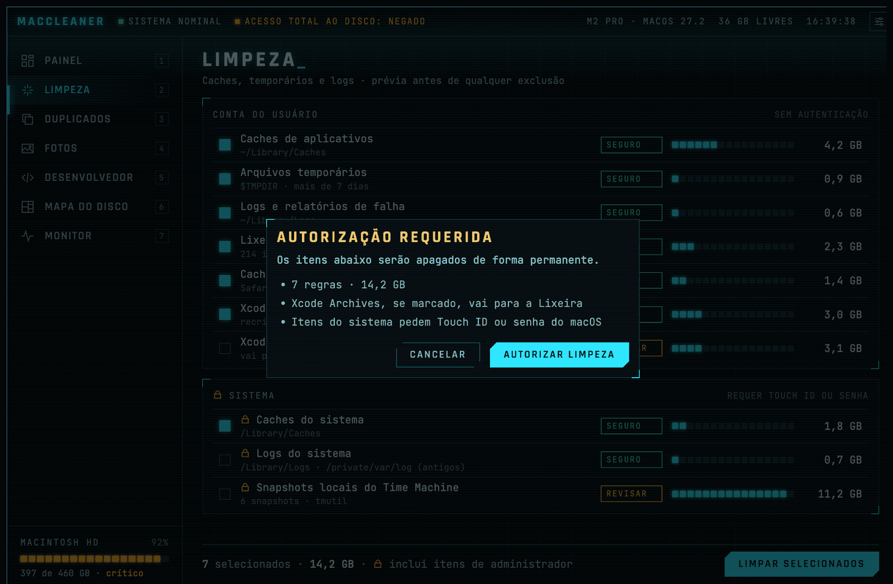
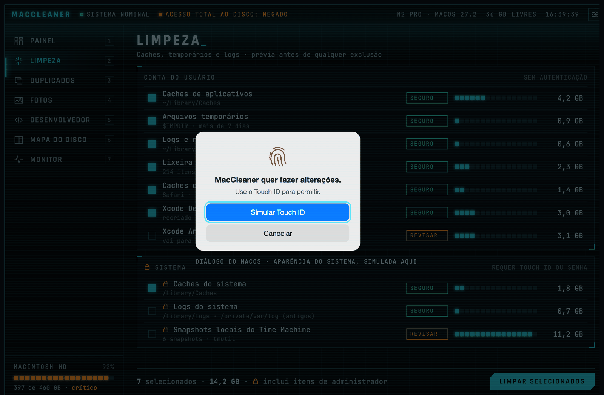

# Segurança

[English](safety.md) · Português

Um limpador apaga arquivos, então um erro pode custar dados. Esta página explica, em linguagem simples, as regras que o MacCleaner segue para isso não acontecer.

> **Como as coisas estão hoje.** O app ainda não apaga nada, e a ferramenta de linha de comando só lê. O motor de exclusão descrito aqui existe e é testado, mas nenhuma tela o usa ainda. Esta página descreve como ele se comporta, para você saber o que esperar quando as telas de limpeza chegarem.

## As cinco regras

### 1. Você sempre vê uma prévia antes

Antes de remover qualquer coisa, o MacCleaner lista exatamente o que vai sair e quanto espaço isso libera. Nada acontece até você confirmar.



### 2. Arquivos pessoais vão para a Lixeira

| O que está sendo removido | Para onde vai | Dá para recuperar? |
|---|---|---|
| Arquivos duplicados, fotos parecidas, arquivos do Xcode (Archives) | A Lixeira | Sim. Abra a Lixeira, clique com o botão direito no item e escolha **Colocar de Volta**. |
| Caches, temporários, logs | Removidos na hora | Não, mas os apps recriam quando precisam. |
| Pastas de build e dependências (`node_modules`, `target`, `bin`/`obj`) | Removidas na hora | Não, mas suas ferramentas recriam na próxima compilação ou instalação. |

Só é removido de vez o que pode ser recriado.

### 3. Alguns lugares nunca podem ser apagados

O MacCleaner se recusa a apagar estes itens, mesmo que um defeito ou uma regra errada peça:

- **Pastas do sistema:** `/System`, `/usr`, `/bin`, `/sbin`, e o nível de cima de `/Library`, `/Applications` e `/Users`.
- **As suas pastas pessoais em si:** a pasta pessoal, Documentos, Mesa, Downloads, Imagens, Filmes, Música.
- **As pastas da Biblioteca em si:** `~/Library`, `~/Library/Caches`, `~/Library/Application Support` e parecidas. O conteúdo pode ser limpo; as pastas ficam.
- **Qualquer coisa dentro de uma pasta `.git`,** que guarda o histórico de um projeto de código.
- **Qualquer coisa dentro de um pacote:** um app (`.app`), uma biblioteca do Fotos (`.photoslibrary`) e parecidos. Apagar pedaços deles os corrompe, então o MacCleaner trata cada um como um item lacrado.
- **Qualquer coisa fora das pastas que você varreu.**

Trocar maiúsculas por minúsculas não contorna isso: `/system` é tratado como `/System`.

### 4. Cada item é conferido de novo logo antes da remoção

Passa um tempo entre a prévia e o seu clique. Por isso, imediatamente antes de remover um item, o MacCleaner olha para ele de novo. Se ele mudou, foi movido ou substituído desde que apareceu na prévia, é pulado e informado, não removido.

Ele também nunca segue atalhos (links simbólicos): um link dentro de uma pasta de cache é removido como link, e aquilo para onde ele aponta fica intocado. E nunca alcança outro disco.

### 5. Tudo o que é removido fica registrado

Cada remoção é gravada em um arquivo de histórico que só a sua conta de usuário consegue ler:

```text
~/Library/Application Support/MacCleaner/history.jsonl
```

Cada linha registra quando aconteceu, o que foi removido e se foi apagado ou enviado para a Lixeira.

## Arquivos do iCloud não são baixados

Arquivos guardados só no iCloud não ocupam espaço no seu Mac. Normalmente, qualquer programa que lê um arquivo desses faz o macOS baixá-lo, o que encheria justamente o disco que você quer liberar.

O MacCleaner avisa o macOS, antes de ler qualquer coisa, que ele não deve baixar arquivos por causa do app. Itens que estão só na nuvem são medidos e identificados, nunca baixados. Se o macOS recusar essa configuração, o MacCleaner para em vez de varrer.

Isso foi testado com arquivos guardados no Mac. O teste contra uma pasta que esteja realmente só na nuvem ainda está na lista.

## Sem rede, sem telemetria

O MacCleaner não se conecta à internet. Não envia dados de uso, não procura atualizações e não tem conta. O que ele descobre sobre o seu disco fica no seu Mac.

## Áreas de administrador (planejado)

Alguns lugares, como `/Library/Caches`, exigem privilégio de administrador. Quando essa limpeza chegar, vai funcionar assim:



- O próprio macOS pede o seu Touch ID ou a sua senha. O MacCleaner nunca vê nem guarda a senha.
- O privilégio de administrador vale só para aquela operação. Nada fica rodando em segundo plano com esse privilégio.
- A parte que roda como administrador aceita só uma lista fixa de regras de limpeza conhecidas, nunca um caminho qualquer.

## Se algo der errado

1. **Olhe na Lixeira.** Arquivos pessoais removidos pelo MacCleaner estão lá. Clique com o botão direito e escolha **Colocar de Volta**.
2. **Leia o arquivo de histórico** para ver exatamente o que foi removido e quando.
3. **Abra uma issue** em [github.com/renatoasterio/MacCleaner/issues](https://github.com/renatoasterio/MacCleaner/issues) contando o que aconteceu. Se parecer um problema de segurança, siga o [SECURITY.md](../../SECURITY.md).

## Para quem quer ver o código

As regras acima são impostas no código e cobertas por testes:

- Regras de caminho: [`protected_paths.rs`](../../crates/maccleaner-domain/src/deletion/protected_paths.rs)
- O único caminho do código que apaga: [`delete_items.rs`](../../crates/maccleaner-application/src/use_cases/delete_items.rs)
- A política completa para quem contribui (em inglês): [docs/security.md](../security.md)
