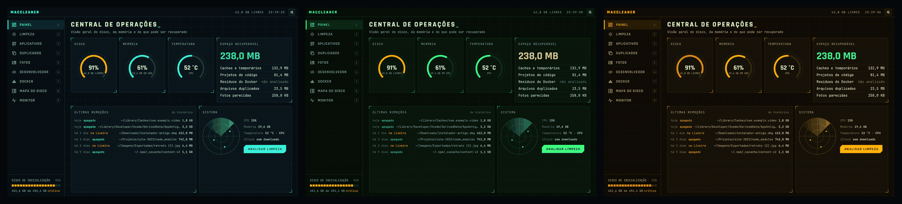
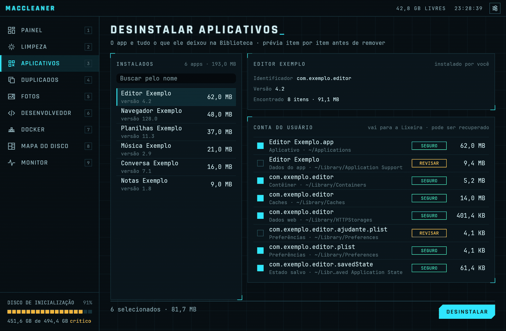
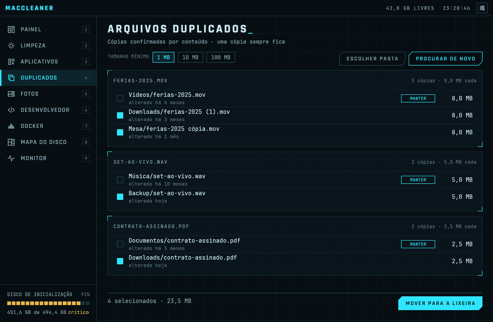
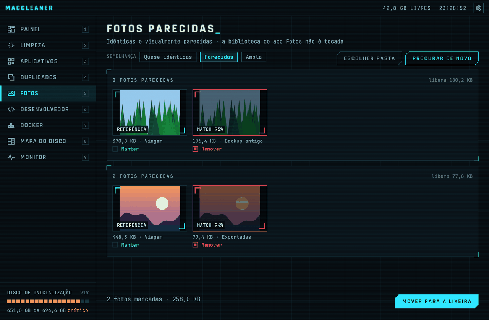
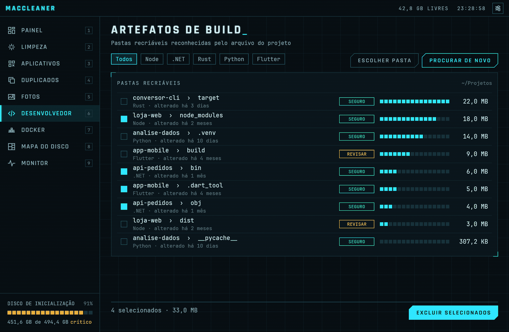
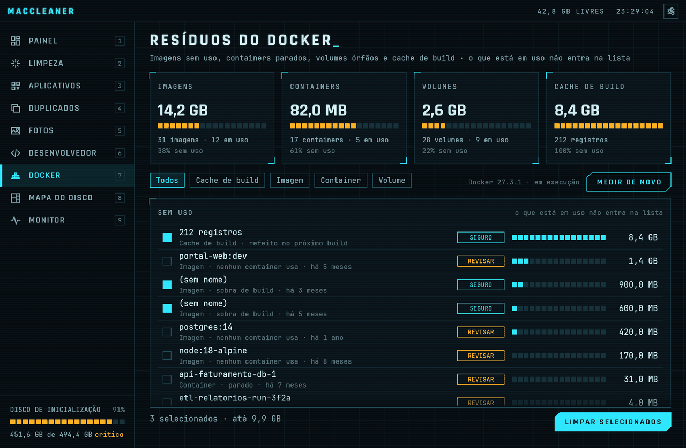
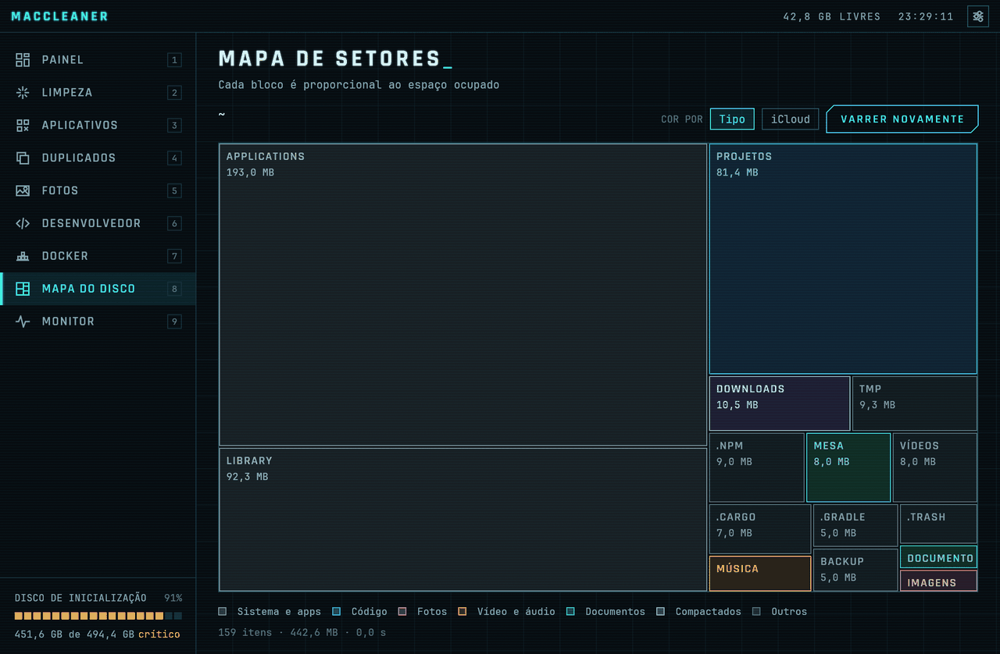
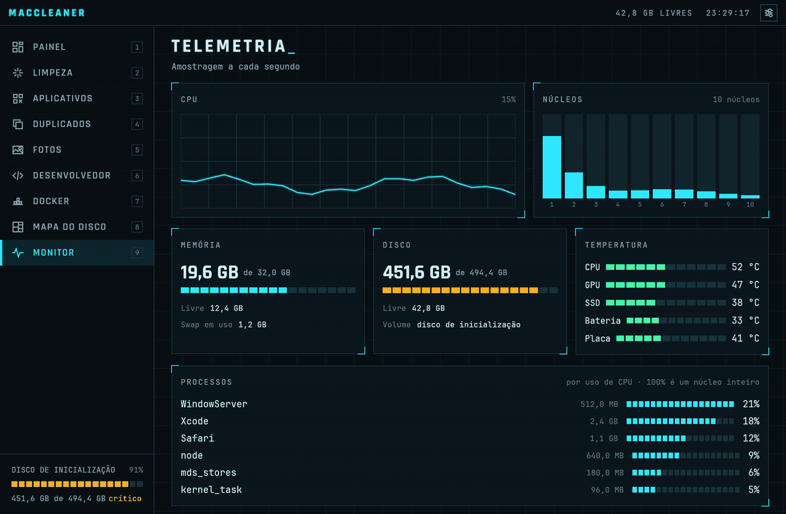

# Usage

English · [Português](usage.pt-BR.md)

How to use each screen of MacCleaner, and its command line tool. If you have not installed it yet, start with [Getting started](getting-started.md).

> The interface is in Portuguese. This guide gives the on-screen word in quotes, followed by its meaning in parentheses the first time it appears.

> The pictures on this page are screenshots of the app with demonstration data. Your folders, sizes and programs will be different.

## The window


| Area | What it shows |
|---|---|
| **Status bar** (top) | The app name, the free space on the startup disk, the time, and the appearance icon. |
| **Navigation rail** (left) | The nine screens, each with its number key. The lit one is where you are. |
| **Disk gauge** (bottom left) | "Disco de inicialização" (startup disk): how full it is. It turns amber and says "crítico" (critical) when less than 10% is free. |
| **Work area** (right) | The title and a one-line description of the current screen, then its content. |

### Keyboard

| Key | Action |
|---|---|
| `1` to `9` | Go to a screen, in the order of the rail |
| `Esc` | Close the appearance panel |
| `Command + Q` | Quit |

### Appearance

Click the sliders icon at the right end of the status bar to open the "Aparência" (appearance) panel.

| Control | Options |
|---|---|
| "Paleta" (palette) | "Agência" (cyan), "Terminal" (green), "Tático" (amber) |
| "Animações" (animations) | "Completa" (full): everything moves. "Reduzida" (reduced): short transitions only, nothing loops. "Desligada" (off): no animation at all. |
| "Brilho" (glow) | How strong the glow around titles and highlights is. All the way left turns it off. |
| "Rever abertura" (replay start-up) | Plays the start-up sequence again. |



Close the panel with `Esc` or by clicking anywhere outside it.

Good to know:

- These choices are not saved: the app opens with the defaults each time.
- If "Reduce motion" is on in the Accessibility part of System Settings, the app starts with "Animações" on "Reduzida" and skips the start-up sequence. You can still choose another level in the panel. This start-up behavior has not been tested with the switch on.
- To save battery, the window redraws only once per second whenever it is not in front.
- With "Completa", the app uses more of the processor while its window is in front (roughly 10 to 15% of one core on an Apple M2 Pro). "Reduzida" lowers that.

### The Full Disk Access notice

macOS hides some folders from every app until you allow it. When that permission is missing, the screens that read your folders ("Limpeza", "Duplicados", "Fotos", "Desenvolvedor" and "Mapa do disco") show one line at the top:

> Sem Acesso Total ao Disco, o macOS esconde parte da sua pasta pessoal das análises. **Abrir ajustes de Acesso Total ao Disco**

It means "Without Full Disk Access, macOS hides part of your home folder from the analyses". Click the link "Abrir ajustes de Acesso Total ao Disco" (open the Full Disk Access settings) to go to the right page of System Settings. The [getting started guide](getting-started.md#step-7-give-full-disk-access-optional) explains the rest.

The app works without the permission. macOS just keeps those folders out of the results.

## How every removal works

Four screens can remove things: "Limpeza", "Duplicados", "Fotos" and "Desenvolvedor". They all follow the same steps, so once you know one you know them all.

1. **The screen looks first.** Searching and analyzing never remove anything.
2. **You see what was found** and choose what goes. Some items come already selected; you can change every choice.
3. **You click the action button** at the bottom right. A dialog called "Autorização requerida" (authorization required) says how many items, how much space, and whether they go to the Trash or are removed for good.
4. **You confirm, or click "Cancelar" (cancel).** Nothing has been removed until you confirm.
5. **"Removendo" (removing).** Each item is checked again right before it is removed. If it changed since you saw it, it is skipped.
6. **"Concluído" (done).** The dialog says how much was freed, how many items were removed and written to the history, and how many were left as they were. Click "Fechar" (close); the screen then looks again, so the list is up to date.

If you click the action button with nothing selected, the screen says "Selecione ao menos um item." (select at least one item) instead of opening the dialog.

The [safety guide](safety.md) explains the rules behind these steps.

## The nine screens

### 1. "Painel" (dashboard)

The summary of the machine and of what the other screens found. It is the picture at the top of this page.

| Part | What it shows |
|---|---|
| "Disco" (disk) | How full the startup disk is, and how much is free. |
| "Memória" (memory) | How much memory is in use. |
| "Temperatura" (temperature) | The hottest temperature sensor. When the Mac reports no sensor, this gauge shows processor use instead, under the title "CPU". |
| "Espaço recuperável" (recoverable space) | The sum of what the other screens found, with one row per source. |
| "Últimas remoções" (latest removals) | The most recent entries of the removal history: when, whether the item was "apagado" (deleted) or sent "na Lixeira" (to the Trash), where it was, and its size. |
| "Sistema" (system) | A radar, a few readings, and the button "Analisar limpeza" (analyze cleanup). |

The rows of "Espaço recuperável":

| Row | Comes from the screen |
|---|---|
| "Caches e temporários" (caches and temporary files) | "Limpeza" |
| "Resíduos do Docker" (Docker leftovers) | "Docker": what Docker itself says removing everything unused would free |
| "Projetos de código" (code projects) | "Desenvolvedor" |
| "Arquivos duplicados" (duplicate files) | "Duplicados" |
| "Fotos parecidas" (similar photos) | "Fotos" |

A row shows "não analisado" (not analyzed) until its screen has run. **Click a row to open its screen.**

The button **"Analisar limpeza"** runs the cleanup analysis right there, without leaving the dashboard. It only measures; it removes nothing. When it finishes, the row "Caches e temporários" shows the result.

### 2. "Limpeza" (cleanup)

Caches, temporary files, logs and other leftovers that apps and tools recreate when they need them.


Step by step:

1. Press `2`. The first time the screen opens, the analysis starts by itself. You see "Analisando" (analyzing). **The analysis removes nothing.**
2. Read the list. Each row is one rule: a checkbox, the name, where it looks, a badge, and how much space it found. A row that found nothing says "vazio" (empty) and cannot be selected.
3. Look at the badges. "Seguro" (safe) means the content is recreated automatically. "Revisar" (review) means it may be worth keeping, so look before selecting.
4. Click a row to select or unselect it. The bottom left shows the total: "7 selecionados · 108,7 MB".
5. Click **"Limpar selecionados"** (clean selected).
6. Read the dialog "Autorização requerida". Then click **"Autorizar limpeza"** (authorize cleanup), or "Cancelar".
7. Read the result in "Concluído" and click "Fechar".

A rule removes the **content** of its folders, never the folders themselves.

#### The "Conta do usuário" group

"Conta do usuário" (user account) holds what your own account can remove, with no authentication. The safe rules that found something come already selected.

| Rule on screen | What it removes | Badge |
|---|---|---|
| "Caches de aplicativos" (app caches) | The content of `~/Library/Caches` | "Seguro" |
| "Arquivos temporários" (temporary files) | The content of your temporary folder, only items that have not changed for 7 days or more | "Seguro" |
| "Logs e relatórios de falha" (logs and crash reports) | The content of `~/Library/Logs` | "Seguro" |
| "Lixeira" (Trash) | Empties the Trash. macOS only shows the Trash to apps with Full Disk Access; without it this row says "vazio". | "Revisar" |
| "Xcode DerivedData" | The content of `~/Library/Developer/Xcode/DerivedData` (build output) | "Seguro" |
| "Caches do simulador" (simulator caches) | The content of `~/Library/Developer/CoreSimulator/Caches` | "Seguro" |
| "Suporte a dispositivos do Xcode" (Xcode device support) | The content of `~/Library/Developer/Xcode/iOS DeviceSupport`. Xcode downloads it again when you connect the device. | "Revisar" |
| "Xcode Archives" | The content of `~/Library/Developer/Xcode/Archives`. **These go to the Trash**, not removed for good. | "Revisar" |
| "Caches de gerenciadores de pacotes" (package manager caches) | The caches of npm, cargo, Gradle, NuGet and pnpm: `~/.npm/_cacache`, `~/.cargo/registry/cache`, `~/.cargo/registry/src`, `~/.gradle/caches`, `~/.nuget/packages`, `~/Library/pnpm/store` | "Seguro" |

> Careful with "Lixeira": emptying the Trash cannot be undone, and the Trash is where MacCleaner sends duplicates and photos. That is why this rule is never selected for you. Select it only when you are sure you want nothing back from the Trash.

#### The "Sistema" group

"Sistema" (system) holds two areas that only an administrator can change. **They are never selected for you.**

| Rule on screen | What it removes | Badge |
|---|---|---|
| "Caches do sistema" (system caches) | The content of `/Library/Caches` | "Seguro" |
| "Logs do sistema" (system logs) | The content of `/Library/Logs` | "Seguro" |

What happens when you select one of them and confirm:

1. The dialog "Autorização requerida" adds the line "As áreas de sistema pedem Touch ID ou a senha de administrador, no diálogo do próprio macOS" (the system areas ask for Touch ID or the administrator password, in macOS's own dialog).
2. After you click "Autorizar limpeza", the rules of your own account are cleaned first.
3. Then **macOS shows its own authentication dialog**, with the text "O MacCleaner precisa de permissão de administrador para limpar as áreas de sistema que você selecionou." (MacCleaner needs administrator permission to clean the system areas you selected). Use Touch ID or type the administrator password. The password goes to macOS; MacCleaner never sees it.
4. If you close that dialog, the system areas stay untouched and the result says "As áreas de sistema não foram limpas: a autenticação foi cancelada." (the system areas were not cleaned: the authentication was cancelled). What was cleaned in step 2 stays cleaned.

Things to know before using it:

- **It needs the installed app.** The system cleanup is done by a small helper program that `cargo xtask install` puts inside the app. When the app runs from the source without that helper, the group shows "só no app instalado · cargo xtask install" (only in the installed app) and its rows cannot be selected.
- **Touch ID or password is decided by macOS,** not by MacCleaner.
- **It has not been verified end to end.** The helper is covered by automated tests on temporary folders, but the macOS dialog and a real cleanup of `/Library/Caches` and `/Library/Logs` were not exercised by the project's tests. See the [safety guide](safety.md#administrator-areas).
- Items that macOS itself protects (System Integrity Protection) cannot be removed even by an administrator. They are reported as left as they were.

### 3. "Aplicativos" (apps)

Uninstalls an app together with what it left in the Library folders: its caches, its settings, its saved windows, its private container. The app calls this screen "Desinstalar aplicativos" (uninstall apps).



Step by step:

1. Press `3`. The first time, the app measures what is installed. You see "Medindo aplicativos" (measuring apps).
2. Find the app in the list "Instalados" (installed), which shows the largest first. Type part of its name in "Buscar pelo nome" (search by name) to narrow the list. A padlock before the name means the App Store or an installer put the app there, so removing it needs an administrator.
3. Click the app. The right side shows its identifier, its version and everything found that belongs to it.
4. Check what is selected. **Items with the badge "Seguro" come already selected. Items with "Revisar" wait for you.**
5. Click **"Desinstalar"** (uninstall), read the dialog, and click **"Desinstalar"** again to authorize.

The items come in two groups:

| Group | What is in it | Where it goes |
|---|---|---|
| "Conta do usuário" (user account) | The app, when you installed it yourself, and what it left in your Library | To the Trash. You can put it back from there. |
| "Sistema" (system) | The app, when the App Store or an installer put it there, and what it left in `/Library` | Removed for good, after macOS asks for Touch ID or the password. An administrator has no Trash of yours to send it to. |

How an item is recognized as the app's:

- **"Seguro":** the item is named exactly after the identifier of the app, such as `com.vendor.editor`, `com.vendor.editor.plist` or `com.vendor.editor.savedState`. A shared container that carries the identifier, such as `group.com.vendor.editor`, counts too.
- **"Revisar":** the name only starts with the identifier (`com.vendor.editor.helper`), or the item is a folder named like the app (`Application Support/Editor`). Something else could be using that name, so these are never selected for you.

What this screen will not do:

- **An app that is open cannot be uninstalled.** It is marked "aberto" (open) in the list, and nothing of it can be selected. Quit the app and click it again. It is checked once more right before the removal.
- **When another copy of the same app is installed, only the app itself is offered.** The two copies share their data.
- **When the app itself cannot be removed here, nothing comes selected.** Removing only what an app left would just reset it.
- **Apps that belong to macOS are not listed.** They live in a part of the disk that cannot be changed.
- **It finds what carries the identifier or the name of the app, not everything the app ever wrote.** A document the app saved somewhere else, or a folder named after its maker, stays.

Where it looks:

| Kind shown | Folders |
|---|---|
| "Dados do app" (app data) | `~/Library/Application Support`, `/Library/Application Support` |
| "Contêiner" (container) | `~/Library/Containers`, `~/Library/Group Containers`, `~/Library/Application Scripts` |
| "Caches" | `~/Library/Caches`, `/Library/Caches` |
| "Dados web" (web data) | `~/Library/HTTPStorages`, `~/Library/WebKit`, `~/Library/Cookies` |
| "Preferências" (settings) | `~/Library/Preferences`, `~/Library/Preferences/ByHost`, `/Library/Preferences` |
| "Estado salvo" (saved state) | `~/Library/Saved Application State` |
| "Logs" | `~/Library/Logs`, `/Library/Logs` |
| "Serviço" (service) | `~/Library/LaunchAgents`, `/Library/LaunchAgents`, `/Library/LaunchDaemons` |
| "Auxiliar" (helper) | `/Library/PrivilegedHelperTools` |

Like the "Sistema" group of the cleanup, the "Sistema" group here needs the installed app. Without it, the group shows "só no app instalado · cargo xtask install" and its items cannot be selected.

### 4. "Duplicados" (duplicates)

Files with exactly the same content, stored more than once.



Step by step:

1. Press `4`.
2. Choose the "Tamanho mínimo" (minimum size): "1 MB", "10 MB" or "100 MB". Smaller files are ignored. A larger minimum makes the search faster.
3. Click **"Escolher pasta"** (choose folder) and pick a folder, or click **"Pasta pessoal"** (home folder) to search your whole home folder.
4. Wait for "Procurando duplicados" (searching for duplicates). "Cancelar" stops the search.
5. Read the groups. Each group is one file that exists in several places: its name, how many copies, and the size of each. In every group, an unchecked copy shows the badge **"Manter"** (keep) and stays; the checked ones will go. By default the oldest copy is the one kept.
6. Click a row to check or uncheck it. You can keep a different copy, or keep them all.
7. Click **"Mover para a Lixeira"** (move to the Trash), read the dialog, and click "Mover para a Lixeira" again to confirm.

What the screen guarantees:

- **At least one copy of each file always stays.** If you try to check the last one, the screen refuses and says "Ao menos uma cópia de cada arquivo precisa ficar."
- **The copies go to the Trash.** You can put them back from there. The disk space is only freed when you empty the Trash.
- **Two files only count as duplicates when the whole content is identical.** Files are compared by size first, then by their beginning and end, then by their whole content (with the BLAKE3 hash). The name does not matter.
- **Hard links are not counted as copies.** Two names for the same stored file take the space only once, so removing one would free nothing.
- **Files that are only in iCloud are never read.** Comparing them would mean downloading them. Empty files, the inside of apps and other packages, and shortcuts (symbolic links) are left out too.

At most 100 groups are shown, the ones that free the most space first. When there are more, the screen says "Mais N grupos menores não são mostrados. Remova os maiores e procure de novo." (N smaller groups are not shown; remove the largest and search again).

After the result, "Procurar de novo" (search again) repeats the search in the same folder, and "Escolher pasta" starts in another one.

### 5. "Fotos" (similar photos)

Photos that look the same even when the files are different: a resized copy, the same picture saved in another format, shots taken in a burst.



Step by step:

1. Press `5`.
2. Choose the level of "Semelhança" (similarity):

   | Level | What it gathers |
   |---|---|
   | "Quase idênticas" (almost identical) | The same picture saved again: another size, format or compression. |
   | "Parecidas" (similar) | Also pictures with small differences, such as shots taken in a burst. This is the default. |
   | "Ampla" (broad) | Also pictures that only resemble each other. Review these carefully. |

3. Click **"Escolher pasta"** and pick a folder, or click **"Procurar em Imagens"** (search in Pictures) to search your Pictures folder.
4. Wait for "Procurando fotos parecidas" (searching for similar photos). "Cancelar" stops the search.
5. Read the groups. Each group shows the photos side by side:
   - The first one is marked **"REFERÊNCIA"** (reference). It is the largest file, most likely the original, and it is kept by default.
   - The others show **"MATCH n%"**: how alike they are to the reference.
   - Under each picture are its size, its folder, and "Manter" (keep) or "Remover" (remove).
6. **Click a picture to switch it between "Manter" and "Remover".**
7. Click **"Mover para a Lixeira"**, read the dialog, and confirm.

What the screen guarantees:

- **At least one photo of each group always stays.** Otherwise the screen says "Ao menos uma foto de cada grupo precisa ficar."
- **The marked photos go to the Trash.** You can put them back from there.
- **The library of the Photos app is never read or changed.** macOS stores that library as one sealed package, and MacCleaner does not open it. Only loose image files in folders are compared.
- **Files that are only in iCloud are never opened.**

What is compared:

- Image files of these formats: JPEG, PNG, HEIC/HEIF, TIFF, BMP, GIF, WebP, and camera RAW (DNG, CR2, CR3, NEF, ARW, RAF, ORF, RW2, SRW, PEF).
- Only files of at least 50 KB. Smaller images are usually icons, not photos.
- A RAW file next to a developed copy with the same name (`IMG_1.CR2` beside `IMG_1.JPG`) is skipped: the pair belongs together.

How photos are matched: each image is reduced to a small signature made of its outline, a map of its brightness, its average color and its proportions. Two photos match only when all four agree. That is why resized or recompressed copies are found, while cropped pictures, mirrored pictures and different pages of text are not treated as the same.

At most 60 groups are shown, the ones that free the most space first. A picture that cannot be drawn shows "sem prévia" (no preview).

### 6. "Desenvolvedor" (developer)

For people who write code: the build and dependency folders that tools recreate by themselves, such as `node_modules`, `target` and `bin`/`obj`. If you do not write code, you can ignore this screen.



Step by step:

1. Press `6`.
2. Click **"Escolher pasta"** and pick the folder where your projects live, or click **"Pasta pessoal"** to search your home folder.
3. Wait for "Procurando projetos" (searching for projects).
4. Read the list "Pastas recriáveis" (folders that can be recreated). Each row is `project › folder`, with the ecosystem, when the project was last changed ("alterado há 2 meses" means changed 2 months ago), a badge and the size. The chips above the list ("Todos", "Node", "Rust"...) filter by ecosystem.
5. Check what is selected. **Folders with the badge "Seguro" in projects untouched for 30 days or more come already selected.** Everything else waits for you.
6. Click **"Excluir selecionados"** (delete selected), read the dialog, and click **"Autorizar exclusão"** (authorize deletion).

**This removal is permanent.** The folders do not go to the Trash. They come back the next time you install dependencies or build the project. No source code is removed.

A folder is offered only when both of these are true:

- **The file that identifies the project is right beside it.** A folder called `target` is offered only next to a `Cargo.toml` or a `pom.xml`, for example.
- **Git has no tracked files inside it.** If part of the folder is under version control, it is project content, not build output. When git cannot answer, the folder is not offered.

What is recognized:

| Ecosystem | Recognized by | "Seguro" folders | "Revisar" folders |
|---|---|---|---|
| Node | `package.json` | `node_modules`, `.next`, `.nuxt`, `.turbo`, `.angular`, `.parcel-cache`, `.svelte-kit` | `dist`, `build`, `coverage`, `out` |
| .NET | `*.csproj`, `*.fsproj`, `*.vbproj`, `*.sln` | `bin`, `obj`, `.vs`, `TestResults` | `packages` |
| Rust | `Cargo.toml` | `target` | |
| Java/Kotlin (Maven) | `pom.xml` | `target` | |
| Java/Kotlin (Gradle) | `build.gradle`, `build.gradle.kts`, `settings.gradle`, `settings.gradle.kts` | `build`, `.gradle` | |
| Python | `pyproject.toml`, `requirements.txt`, `setup.py`, `Pipfile` | `.venv`, `venv`, `__pycache__`, `.pytest_cache`, `.mypy_cache`, `.ruff_cache`, `.tox` | `build`, `dist` |
| Swift (packages) | `Package.swift` | `.build` | |
| Swift (CocoaPods) | `Podfile` | `Pods` | |
| Flutter | `pubspec.yaml` | `.dart_tool` | `build` |
| Go | `go.mod` | | `vendor` |
| PHP | `composer.json` | | `vendor` |
| Terraform | `*.tf` | `.terraform` | |

"Revisar" folders have common names that a project might use for real content, so they are never selected for you.

When you search the home folder, the folders Library, Applications, Pictures, Movies, Music and the Trash are skipped: they hold no code projects and are slow to read.

### 7. "Docker"

For people who use Docker: what Docker holds that no container uses. The app calls this screen "Resíduos do Docker" (Docker leftovers). If you do not use Docker, you can ignore it.



Step by step:

1. Press `7`. The app asks Docker what it holds. You see "Perguntando ao Docker" (asking Docker). With many images and volumes, this takes some seconds.
2. Read the four panels at the top: "Imagens" (images), "Containers", "Volumes" and "Cache de build" (build cache). Each one shows how much space that kind takes, how many there are, and the share that nothing uses ("sem uso").
3. Read the list "Sem uso" (unused). Each row has a name, what it is, how long ago it was made, a badge and a size. The chips above the list filter by kind.
4. Check what is selected. **Only the build cache and the images without a name come already selected.** Both are leftovers of builds, and the next build makes them again.
5. Click **"Limpar selecionados"** (clean selected), read the dialog, and click **"Autorizar limpeza"** (authorize cleanup).

**This removal is permanent, and Docker itself does it.** What Docker holds is not made of files the app can reach, so nothing goes to the Trash.

What is listed:

| Kind | Listed when | Badge |
|---|---|---|
| "Cache de build" | There is any. It is removed as a whole. | "Seguro" |
| "Imagem" (image) without a name | No container uses it | "Seguro" |
| "Imagem" with a name | No container uses it, running or stopped | "Revisar": an image you built may exist nowhere else |
| "Container" | It is stopped | "Revisar": what it wrote while it ran is lost |
| "Volume" | No container uses it | "Revisar": a volume may hold a database |

Things to know:

- **What is in use never enters the list.** If something comes into use after the list was made, Docker refuses to remove it and it stays. The result dialog counts those.
- **The total says "até" (up to).** Images share parts, so removing two of them can free less than their sizes added up. The result dialog shows what Docker really freed, measured before and after.
- **"Docker não encontrado" (Docker not found)** means no Docker program was found on this Mac. **"Docker parado" (Docker stopped)** means it is installed but closed: open Docker, wait for it to start, and click "Verificar de novo" (check again). The app does not start Docker for you.
- **"Medir de novo" (measure again)** asks Docker again.
- **The space is freed inside Docker.** Docker Desktop keeps everything in one large file on the Mac, and that file may not shrink at once.

### 8. "Mapa do disco" (disk map)

A map of what uses the disk. Each block is as large as the space it takes. The app calls it "Mapa de setores" (sector map). This screen only reads: nothing can be deleted from it.



Step by step:

1. Press `8`.
2. Click **"Pasta pessoal"** to measure your home folder, or **"Disco inteiro"** (whole disk) to measure the startup disk. macOS may ask for permission to read Documents, Desktop and Downloads.
3. Wait for "Varrendo" (scanning). The note "iCloud: sem downloads" reminds you that nothing is being downloaded. "Cancelar" stops the scan.
4. **Move the pointer over a block** to see its card: "Tamanho" (size and share of the map), "Itens" (items), "iCloud" (where the content lives) and "Tipo" (type).
5. **Click a folder block to zoom into it.**
6. **Use the trail of names above the map to go back.** Click any name in it to return to that folder.
7. **Right-click a block to show it in Finder.**

The controls above the map:

| Control | What it does |
|---|---|
| "Cor por" (color by) "Tipo" (type) | Colors each block by kind of content: "Sistema e apps" (system and apps), "Código" (code), "Fotos" (photos), "Vídeo e áudio" (video and audio), "Documentos" (documents), "Compactados" (archives), "Outros" (others). |
| "Cor por" "iCloud" | Colors each block by where it lives: "Somente local" (only on this Mac), "iCloud, baixado" (in iCloud and also on this Mac), "Somente na nuvem" (only in iCloud, taking no space here). |
| "Varrer novamente" (scan again) | Measures the same place again. |

The line under the map shows how many items were measured, their total size and how long the scan took. If macOS did not let the app open some folders, it adds "N pastas sem acesso" (folders without access) and the link "Abrir ajustes de Acesso Total ao Disco".

Good to know:

- **Scans never start an iCloud download.** Files that are only in iCloud are measured and labeled, not fetched.
- A level shows at most 40 blocks. The smallest ones are joined into one block called "outros" (others).
- Apps, Photos libraries and other packages appear as one sealed block.
- "Disco inteiro" leaves two things out on purpose: other disks connected to the Mac, and the internal volume macOS shows twice, which would count every file two times.

### 9. "Monitor"

The machine, live. The app calls this screen "Telemetria" (telemetry).



| Panel | What it shows |
|---|---|
| "CPU" | Processor use over the last two minutes, and the current percentage. |
| "Núcleos" (cores) | One bar per processor core. |
| "Memória" (memory) | Memory in use out of the total, "Livre" (free) and "Swap em uso" (swap in use). |
| "Disco" (disk) | Space used on the startup disk out of the total, and "Livre". |
| "Temperatura" (temperature) | Temperatures grouped by component: "CPU", "GPU", "SSD", "Bateria" (battery), "Placa" (board). Only the components your Mac reports appear. |
| "Processos" (processes) | The six programs using the most processor, with their memory. Here 100% is one whole core, so a program can pass 100%. |

How often the readings change: processor and memory every second, the list of programs every 2 seconds, temperatures every 5 seconds.

Good to know:

- If the Mac reports no temperature sensor, the panel says "Este Mac não informou nenhum sensor de temperatura."
- There are no fan speeds.
- This screen only reads. It cannot stop a program.

## The command line tool

`maccleaner-cli` runs the same scan engine as the app, from the Terminal. It is read-only: it never changes or deletes anything.

Run it from the project folder:

```bash
cargo run --release -p maccleaner-cli -- scan ~/Documents
```

### What `scan` accepts

```text
maccleaner-cli scan [--top <N>] <PATH>
```

| Part | Meaning | Default |
|---|---|---|
| `<PATH>` | The folder to measure | required |
| `--top <N>` | How many of the largest items to list | 15 |

Examples:

```bash
cargo run --release -p maccleaner-cli -- scan ~
```

```bash
cargo run --release -p maccleaner-cli -- scan ~/Projects --top 30
```

### Reading the result

```text
Pasta              /Users/you/Projects
Itens              1.386.543
Ocupado em disco   24,2 GB
Tamanho lógico     20,6 GB
Somente na nuvem   0 B
Pastas sem acesso  0
Tempo              9,3 s

Maiores itens
     12,5 GB  portal-web/
     11,7 GB  app-mobile/
    249,9 KB  notes.txt
```

| Line | Meaning |
|---|---|
| "Pasta" | The folder that was measured. |
| "Itens" | How many files and folders are inside it. |
| "Ocupado em disco" | The space those items really take on the disk. This is the number that matters when you want to free space. |
| "Tamanho lógico" | The size of the content itself. It differs from the line above because the disk stores files in blocks and can compress them. |
| "Somente na nuvem" | Content that exists only in iCloud. It takes no space on this Mac, and MacCleaner does not download it. |
| "Pastas sem acesso" | Folders macOS did not let the Terminal open. See the next section. |
| "Tempo" | How long the scan took. |
| "Maiores itens" | The largest items directly inside the folder. A `/` after the name marks a folder; "(pacote)" marks an app or a library measured as one item. |

Numbers use the Brazilian format: a comma for decimals and a dot for thousands.

### When "Pastas sem acesso" is not zero

macOS protects some folders, such as Mail, Safari and other apps' data. The command line tool runs inside the Terminal, so here it is the Terminal that needs **Full Disk Access**, not MacCleaner:

1. Open **System Settings**.
2. Go to **Privacy & Security**, then **Full Disk Access**.
3. Turn on the switch next to **Terminal** (or the terminal app you use).
4. Quit the Terminal and open it again.

This only lets the Terminal read those folders. You can turn it off the same way.

### Measuring the whole disk

```bash
cargo run --release -p maccleaner-cli -- scan /
```

This takes longer and needs Full Disk Access to be complete. Two things are left out on purpose: other disks connected to the Mac, and the internal volume macOS shows twice, which would count every file two times.

### Previewing the apps and Docker screens

Two more commands print what the "Aplicativos" and "Docker" screens would find. Like `scan`, they remove nothing.

```bash
cargo run --release -p maccleaner-cli -- apps
```

Lists the installed apps, largest first, with the version and who can remove each one: "usuário" (you) or "admin" (an administrator).

```bash
cargo run --release -p maccleaner-cli -- apps Docker
```

With the name of an app, shows what uninstalling it would remove: each item with its kind, its badge and its size.

```bash
cargo run --release -p maccleaner-cli -- docker
```

Shows how much Docker holds of each kind and lists what nothing uses.

## Next

- [Safety](safety.md): what MacCleaner can and cannot delete, and what has not been tested yet.
- [Questions and troubleshooting](faq.md).
