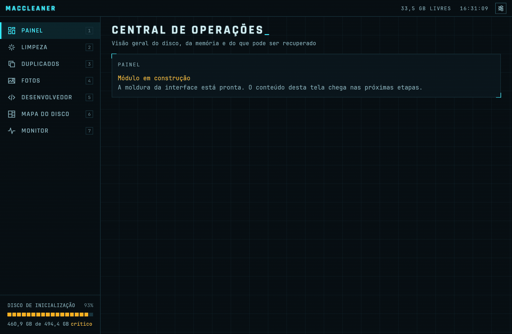
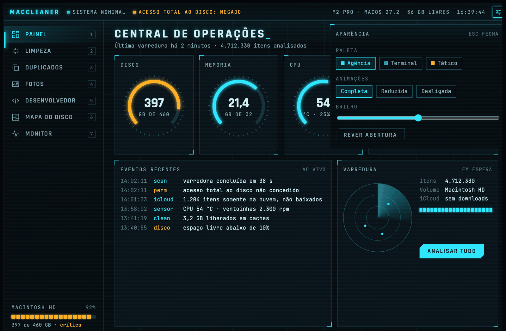

# Uso

[English](usage.md) · Português

Como usar a janela do MacCleaner e a ferramenta de linha de comando. Se ainda não instalou, comece pelos [Primeiros passos](getting-started.pt-BR.md).

## A janela



| Área | O que mostra |
|---|---|
| **Barra de status** (em cima) | O nome do app, o espaço livre no disco de inicialização, a hora e o ícone de aparência. |
| **Trilho de navegação** (à esquerda) | As sete telas. A que está acesa é onde você está. |
| **Medidor do disco** (embaixo, à esquerda) | Quão cheio está o disco de inicialização. Fica âmbar e mostra "crítico" quando há menos de 10% livre. |
| **Área de trabalho** (à direita) | O título e uma descrição de uma linha da tela atual, e depois o conteúdo. |

### Teclado

| Tecla | Ação |
|---|---|
| `1` a `7` | Ir para uma tela, na ordem do trilho |
| `Esc` | Fechar o painel de aparência |
| `Command + Q` | Sair |

### Aparência

Clique no ícone de controles, na ponta direita da barra de status, para abrir o painel "Aparência".



| Controle | Opções |
|---|---|
| Paleta | Agência (ciano), Terminal (verde), Tático (âmbar) |
| Animações | **Completa:** tudo se move. **Reduzida:** só transições curtas, nada fica em repetição. **Desligada:** nenhuma animação. |
| Brilho | A intensidade do brilho em volta de títulos e destaques. Todo para a esquerda desliga. |
| Rever abertura | Mostra de novo a sequência de abertura. |

Feche o painel com `Esc` ou clicando fora dele. Essas escolhas ainda não são salvas: o app abre com os padrões a cada vez.

Para poupar bateria, as animações caem para um quadro por segundo sempre que a janela não está na frente.

## As sete telas

Cada tela está sendo construída para ficar igual ao protótipo. Até lá, mostra "Módulo em construção". Clique no nome para ver o desenho.

| Tecla | Tela | O que vai fazer | Estado |
|---|---|---|---|
| `1` | [Painel](../assets/screens/dashboard.png) | Resumo do disco, da memória, da temperatura e do espaço que dá para recuperar | Em andamento |
| `2` | [Limpeza](../assets/screens/cleanup.png) | Caches, temporários e logs, com uma etiqueta de risco em cada item | Em andamento |
| `3` | [Duplicados](../assets/screens/duplicates.png) | Arquivos com conteúdo idêntico. Uma cópia sempre fica. | Em andamento |
| `4` | [Fotos](../assets/screens/photos.png) | Fotos idênticas e visualmente parecidas nas suas pastas | Em andamento |
| `5` | [Desenvolvedor](../assets/screens/developer.png) | Pastas de build e de dependências de projetos de código | Em andamento |
| `6` | [Mapa do disco](../assets/screens/disk-map.png) | Um mapa em que cada bloco tem o tamanho do espaço que ocupa | Em andamento |
| `7` | [Monitor](../assets/screens/monitor.png) | Processador, memória, disco, ventoinhas e temperaturas, ao vivo | Em andamento |

## A ferramenta de linha de comando

O `maccleaner-cli` roda o mesmo motor do app, pelo Terminal. Ele é somente leitura: nunca altera nem apaga nada.

Rode a partir da pasta do projeto:

```bash
cargo run --release -p maccleaner-cli -- scan ~/Documents
```

### O que o `scan` aceita

```text
maccleaner-cli scan [--top <N>] <PASTA>
```

| Parte | Significado | Padrão |
|---|---|---|
| `<PASTA>` | A pasta a medir | obrigatório |
| `--top <N>` | Quantos dos maiores itens listar | 15 |

Exemplos:

```bash
cargo run --release -p maccleaner-cli -- scan ~
```

```bash
cargo run --release -p maccleaner-cli -- scan ~/Projetos --top 30
```

### Como ler o resultado

```text
Pasta              /Users/voce/Projetos
Itens              1.386.543
Ocupado em disco   24,2 GB
Tamanho lógico     20,6 GB
Somente na nuvem   0 B
Pastas sem acesso  0
Tempo              9,3 s

Maiores itens
     12,5 GB  portal-web/
     11,7 GB  app-mobile/
    249,9 KB  notas.txt
```

| Linha | Significado |
|---|---|
| Pasta | A pasta que foi medida. |
| Itens | Quantos arquivos e pastas há dentro dela. |
| Ocupado em disco | O espaço que esses itens realmente tomam no disco. É o número que importa quando você quer liberar espaço. |
| Tamanho lógico | O tamanho do conteúdo em si. Difere da linha de cima porque o disco guarda arquivos em blocos e pode compactá-los. |
| Somente na nuvem | Conteúdo que existe só no iCloud. Não ocupa espaço neste Mac, e o MacCleaner não o baixa. |
| Pastas sem acesso | Pastas que o macOS não deixou o Terminal abrir. Veja a próxima seção. |
| Tempo | Quanto a varredura demorou. |
| Maiores itens | Os maiores itens diretamente dentro da pasta. Uma `/` depois do nome indica pasta; "(pacote)" indica um app ou uma biblioteca medidos como um item só. |

### Quando "Pastas sem acesso" não é zero

O macOS protege algumas pastas, como as do Mail, do Safari e os dados de outros apps. Para a varredura conseguir lê-las, dê ao Terminal o **Acesso Total ao Disco**:

1. Abra os **Ajustes do Sistema**.
2. Vá em **Privacidade e Segurança** e depois em **Acesso Total ao Disco**.
3. Ligue a chave ao lado de **Terminal** (ou do app de terminal que você usa).
4. Encerre o Terminal e abra de novo.

Isso só permite que o Terminal leia essas pastas. Você pode desligar do mesmo jeito.

### Medindo o disco inteiro

```bash
cargo run --release -p maccleaner-cli -- scan /
```

Demora mais e precisa do Acesso Total ao Disco para ficar completo. Duas coisas ficam de fora de propósito: outros discos conectados ao Mac e o volume interno que o macOS mostra duas vezes, o que contaria cada arquivo em dobro.

## A seguir

- [Segurança](safety.pt-BR.md): o que o MacCleaner pode e não pode apagar.
- [Perguntas e solução de problemas](faq.pt-BR.md).
